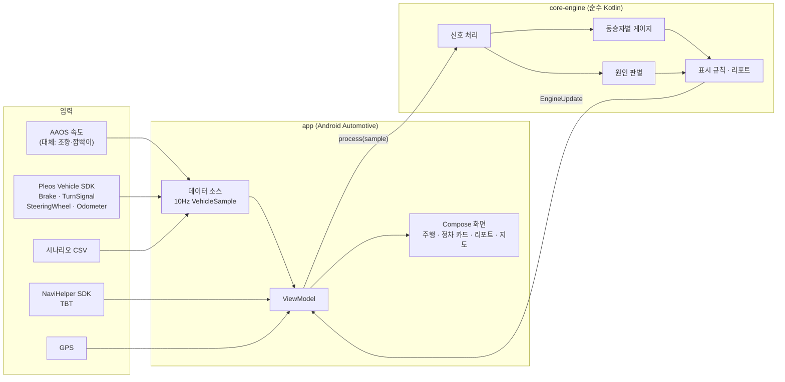
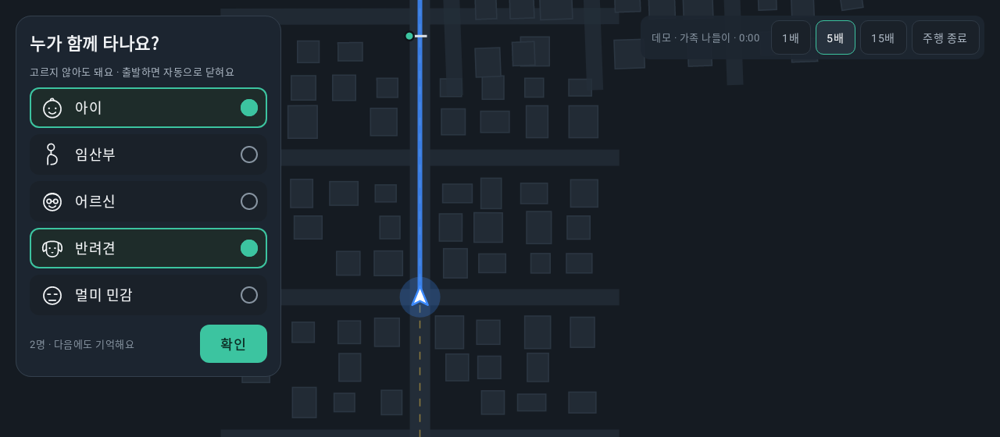
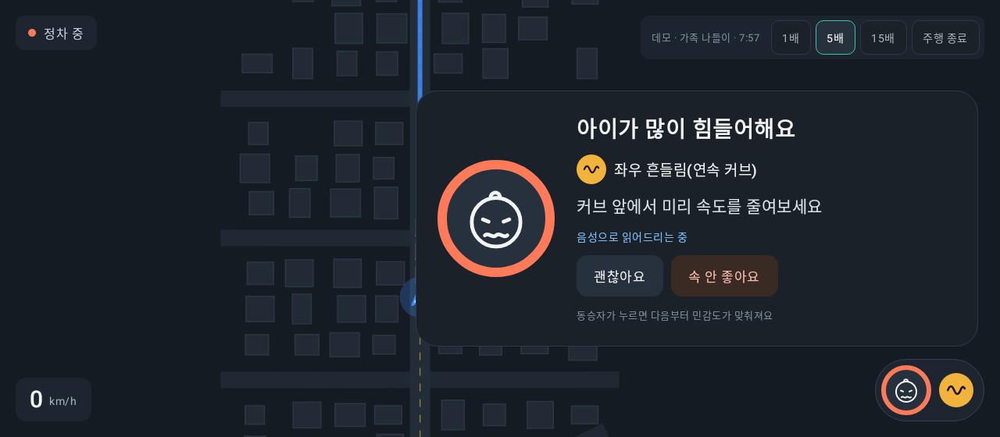
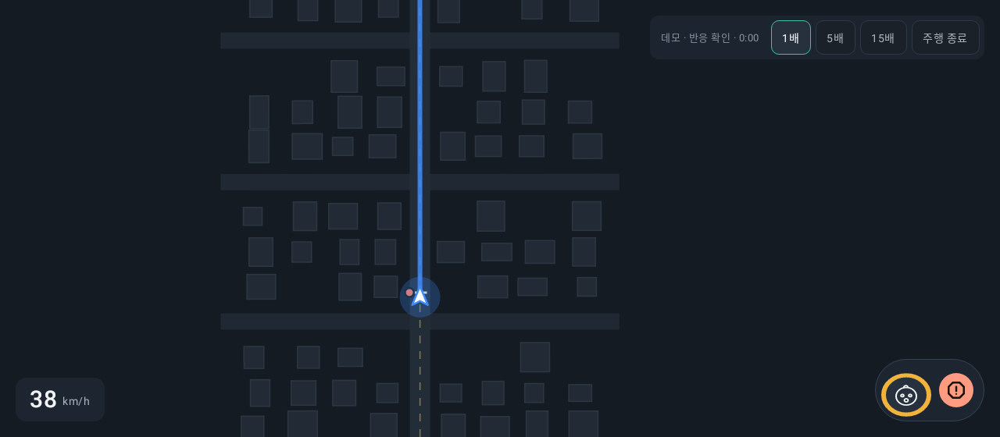
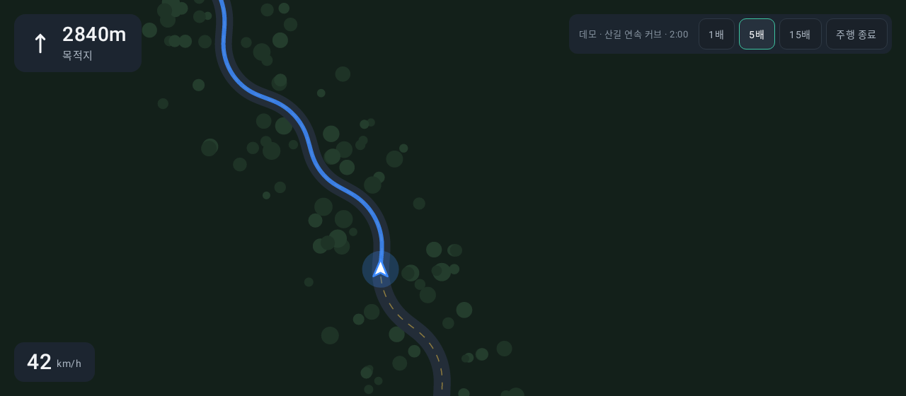
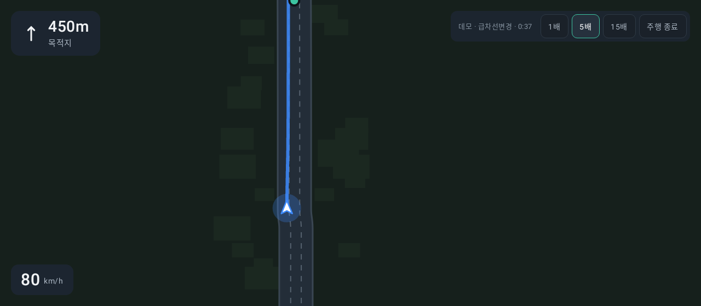

# 다 타유 (DataYou)

> **"다 타유"** — 운전자가 느끼지 못하는 동승자의 멀미를 차량 데이터로 읽어, 고칠 수 있는 원인 하나만 알려주는 Pleos Connect 앱


| 바로가기 | |
|---|---|
| 📘 [아키텍처·기능 개요](docs/overview/index.html) | 주제별 10페이지 인터랙티브 문서 (게이지 시뮬레이터, 경로 뷰어 포함) |
| 📐 [소프트웨어 설계 문서 (SDD)](docs/design/SDD.md) | 요구사항, 구조, 알고리즘, 대체 경로, 테스트 추적성 |
| 🎭 [캐릭터 애니메이션 주입](docs/design/character-animation.md) | 반응 동작을 JSON·코드로 교체하는 방법 |
| ▶️ [실행·시연 가이드](docs/guides/run-and-demo.md) | 브라우저 → 엔진 → 에뮬레이터 → 실시간 시연 |
| 🎞️ [인터랙티브 프로토타입](docs/prototype/index.html) | 엔진이 계산한 주행을 차량 화면으로 재생 |
| 📦 APK | 저장소 Releases의 `datayou-m3-debug.apk` |

---

## 무엇을 하나

운전자는 차가 어떻게 움직일지 스스로 예측할 수 있어 동승자보다 멀미를 덜 느낍니다. 뒷좌석의 아이, 임산부, 반려견은 다릅니다. 다 타유는 차량 데이터로 **동승자별 멀미 게이지**를 계산하고, 게이지를 올린 **운전 원인 7종**을 구분해 알려줍니다.

| 순간 | 보여주는 것 | 원칙 |
|---|---|---|
| 주행 중 | 가장 힘든 동승자의 얼굴 + 원인 배지 1개. 몸이 쏠리면 캐릭터가 그 방향으로 쏠린 자세로 바뀜, 부드럽게 달리면 편안히 쉬는 표정 | 글자 없음, **움직이는 요소 없음**, 배지 30초 유지, 단계가 오를 때만 효과음 |
| 정차 시 | 원인과 개선 팁 카드("방금 이렇게 쏠렸어요" 동작 재생), 음성 안내, "괜찮아요 / 속 안 좋아요" | 운전 중 읽게 하지 않음 |
| 하차 후 | 원인별 기여 비율, 10km당 이벤트, 다음 주행 팁 하나 | 정체처럼 고칠 수 없는 건 탓하지 않음 |

동승자 유형(아이·임산부·어르신·반려견·멀미 민감·일반)마다 민감도가 달라 같은 운전에도 게이지가 다르게 오릅니다. 회전 300m 전에는 내비 안내(TBT)를 보고 미리 감속을 유도합니다.

## 원인 7종

| 구분 | 원인 | 판별 기준 (초기값) | 코칭 |
|---|---|---|---|
| 순간 | 브레이크 급제동 | 감속 ≥ 3.0m/s² 0.3초 이상 + 브레이크 밟음 | 조금 일찍, 약하게 |
| 순간 | 회생·관성 급감속 | 감속 ≥ 3.0m/s² + 브레이크 안 밟음 | 회생제동 단계 낮추기 |
| 순간 | 급출발 | 가속 ≥ 2.5m/s² 0.3초 이상 | 출발은 천천히 |
| 순간 | 급차선변경·급회전 | 좌우 ≥ 3.0m/s² (직전 4초 안에 깜빡이 → 차선 변경, 없으면 회전) | 여유 있게 |
| 반복 | 브레이크 끊어 밟기 | 시속 15km 이상에서 60초에 브레이크 6회 이상 | 한 번에 부드럽게 |
| 반복 | 좌우 흔들림(연속 커브) | 30초 안에 좌우 방향 전환 4회 이상 | 커브 앞에서 미리 감속 |
| 상황 | 정체 가다 서다 | 120초 안에 정지 3회 이상, 최고 시속 30km 이하 | **코칭 없음** (운전자 탓 아님) |

순간 이벤트 기준값에는 동승자별 배율이 곱해집니다(예: 임산부 0.75배). 모든 기준값은 [`EngineConfig.kt`](core-engine/src/main/kotlin/team/datayou/engine/EngineConfig.kt) 한 곳에 있습니다.

## 멀미 게이지

```
대역 흔들림  = 0.1~0.5Hz 성분만 남긴 앞뒤·좌우 가속도
게이지 증가  = 대역 흔들림² × 0.18 × 동승자 민감도  (+ 순간 이벤트 +6, 반복 패턴 +4)
회복        = 흔들림이 거의 없으면 초당 0.17
단계        = 0~100 · 40 이상 주의 · 70 이상 힘듦 (내려갈 때 8만큼 여유)
```

ISO 2631-1의 멀미 누적 개념(약 0.2Hz에서 가장 민감)을 **출발점**으로 삼았습니다. 이 모델은 수직 진동 기준이라 차량 멀미 예측에는 한계가 있다는 연구가 있어(Bos 외, 2022), 앞뒤·좌우 방향과 동승자 피드백 보정을 더했습니다.

---

## 아키텍처



- **엔진과 앱 분리:** `core-engine`은 Android에 의존하지 않아 PC에서 바로 테스트하고, 시나리오 재생과 실차에 같은 엔진을 씁니다.
- **입력 하나로 통일:** 어떤 데이터 소스든 `VehicleSample`(속도, 요레이트, 방위, 브레이크, 깜빡이)로 바꿔 넣습니다. 없는 값은 `null`이고 엔진이 대체 경로로 처리합니다.
- **채널별 대체 경로:** 차종마다 지원 API가 다르므로 채널별로 지원을 확인하고, 안 되는 채널만 비우거나 대체합니다.

| 채널 | 1순위 | 대체 | 못 받으면 |
|---|---|---|---|
| 속도 | AAOS `PERF_VEHICLE_SPEED` | GPS 속도 | 실시간 불가 안내 |
| 브레이크 | Vehicle SDK `Brake` | — | 급감속 = 급제동 |
| 방향지시등 | Vehicle SDK `TurnSignal` | AAOS `TURN_SIGNAL_STATE` | 좌우 이벤트 = 급회전 |
| 핸들 각도 | Vehicle SDK `SteeringWheel` | AAOS `PERF_STEERING_ANGLE` → GPS 방위 | 좌우 판단 생략 |
| 주행거리 | Vehicle SDK `Odometer` | 속도 적분 | — |
| 다음 회전 | NaviHelper TBT | — | 예측 안내 생략 |

자세한 설계는 [SDD](docs/design/SDD.md)에 있습니다.

## Pleos Connect SDK 사용 현황

| SDK / API | 용도 | 상태 |
|---|---|---|
| AAOS `PERF_VEHICLE_SPEED` | 가감속·급격함 | ✅ |
| **Vehicle SDK 2.3.2** `Brake` · `TurnSignal` · `SteeringWheel` · `Odometer` | 원인 구분, 좌우 가속(핸들 각도 → 자전거 모델), 리포트 거리. `check…Capabilities` 후 연결 | ✅ 구현 · 에뮬레이터 검증 중 |
| **NaviHelper SDK 3.0.5** `addListener` · `getTBTInfo` | 다음 회전 예측 안내 | ✅ 구현 · 에뮬레이터 검증 중 |
| AAOS `PERF_STEERING_ANGLE` · `TURN_SIGNAL_STATE` | Pleos 미탑재 환경 대체 경로 | ✅ |
| Android GPS · OpenStreetMap(osmdroid) | 실시간 지도, 좌우 대체 경로 | ✅ |
| Gleo AI TTS (기기 내) | 정차 시 음성 (현재 Android 기본 TTS) | PT 전 |
| AAOS 기어·시동·주차 브레이크, `CarUxRestrictionsManager` | 자동 시작·종료, 화면 제약 연동 | PT 전 |
| Gleo STT·LLM, Vehicle SDK HVAC·Window | 음성 보정, 리포트 요약, 자동 케어 | Todo |

Vehicle·NaviHelper SDK는 Pleos 공개 Maven 저장소에서 받으며 인증 키가 필요 없습니다.

---

## 화면

주행을 시작하면 내비 화면 왼쪽(운전석 쪽)에 동승자 팝업이 뜹니다. 고르지 않아도 바로 출발할 수 있고(일반 동승자 기준), 고른 값은 저장되어 다음 주행의 팝업이 같은 값으로 열립니다. 차가 5km/h 이상으로 움직이면 팝업은 효과 없이 바로 닫힙니다.


| 출발 전 · 동승자 팝업 (선택) | 주행 중 · 주의 |
|---|---|
|  |  |
| **정차 시 · 코칭 카드** | **하차 · 주행 리포트** |
|  |  |

### 캐릭터 반응
급출발하면 뒤로 젖혀지고, 급제동·회생 감속이면 앞으로 쏠리고, 급회전·커브에서는 원심력 방향으로 기울어집니다. 고칠 이벤트 없이 1분 넘게 부드럽게 달리면 편안히 쉬는 표정이 됩니다.

**주행 중에는 움직이지 않습니다.** 반응은 쏠린 *정지 자세*로 2.5초 보였다가 돌아오고, 실제 동작은 정차 카드에서만 재생합니다. 시야 가장자리의 움직임은 시선을 강하게 끌기 때문이며, Android for Cars 앱 품질 기준 SA-1(주행 중 움직이는 그래픽 금지, 정차 중 운전과 관련된 애니메이션만 예외)을 따릅니다. 이 원칙은 "주행 중 화면이 시간이 지나도 픽셀 단위로 같은지" 테스트로 고정했습니다.

| 앞으로 쏠림 (급제동) | 뒤로 젖힘 (급출발) | 오른쪽 기울어짐 (왼쪽 차선 변경) | 휴식 (부드러운 주행) |
|---|---|---|---|
|  |  |  |  |

**애니메이션은 바깥에서 주입합니다.** 엔진은 어떤 반응인지만 정하고, 동작은 JSON 키프레임(재빌드 없이 교체 가능) 또는 `ReactionMotion` 구현으로, 그림은 `CharacterRenderer`로 바꿀 수 있습니다 → [캐릭터 애니메이션 설계·주입 가이드](docs/design/character-animation.md)

### 지도
- **시나리오 모드:** 주행 데이터의 속도·회전만으로 실제 지나간 길을 복원해 그립니다. 도로 유형(시내·간선·고속도로·굽이길), 차로 위치, 정차 지점, 회전 지점도 데이터에서 찾으므로 지도·회전 안내·게이지 반응이 서로 맞습니다.
- **실시간 모드:** OpenStreetMap 실제 지도를 GPS로 따라갑니다. 구글 서비스·API 키가 필요 없어 Pleos 차량에서도 동작합니다. 위치를 받기 전에는 서울시청 기준으로 지도를 보여주고, 차량 신호가 오지 않아도 GPS 위치로 지도가 움직입니다. 인터넷이 없으면 화면 위에 안내가 뜹니다.

| 산길 연속 커브 | 고속도로 급차선변경 | 정체 가다 서다 |
|---|---|---|
|  |  |  |
| **시내 정차 (신호등)** | **교차로 우회전 안내** | **강변 커브 (힘듦)** |
|  |  |  |

스크린샷은 `./gradlew :app:testDebugUnitTest`가 Robolectric으로 실제 Compose 화면을 렌더링한 결과이고, 값은 엔진이 실제로 계산한 것입니다.

---

## 빠른 시작

```bash
./gradlew :core-engine:test :app:testDebugUnitTest      # 자동 테스트 60개
./gradlew :core-engine:run --args="summary CHILD"        # 9개 시나리오 결과 표
./gradlew :app:assembleDebug                             # APK 빌드 (시연용: 첫 화면에서 시나리오 선택)
./gradlew :app:assembleDebug -PdemoMode=false            # 실차용: 첫 화면 없이 실시간 데이터로 바로 주행 화면
```

필요한 것: JDK 17 (Android Studio JBR이면 됩니다). Windows는 `gradlew.bat`을 씁니다. 에뮬레이터 실행과 실시간 시연(차량 신호 주입)은 [실행·시연 가이드](docs/guides/run-and-demo.md)를 보세요.

> ⚠️ Automotive 에뮬레이터에서 `Activity class … does not exist`가 뜨면 멀티유저 설치 문제입니다 → [설치 문제 해결](docs/guides/troubleshooting-aaos-install.md)

## 검증

**자동 테스트 60개** — 엔진 32개(시나리오별 원인 판별, 동승자 차이, 배지·효과음 규칙, 예측 안내, 피드백 보정, 조향각 변환, GPS 방위 회귀, 캐릭터 반응·휴식), 앱 28개(화면 스냅샷 6, 시나리오 지도 6, 실시간 지도 1, 캐릭터 반응·주행 중 고정·정차 재생 7, 애니메이션 주입 6, 동승자 기억 2).

합성 시나리오 9종을 동승자 '아이'로 재생한 결과입니다. 시나리오는 실제 도로 형상(커브 반경 50~80m·회전각 45~80°, 교차로 90° 회전, 2.3초에 한 차로 이동)으로 만들었습니다.

| 시나리오 | 최고 게이지 | 감지된 원인 | 다음 주행 팁 |
|---|---|---|---|
| `family_trip` 가족 나들이 | 82 | 브레이크 급제동 2, 회생·관성 급감속 3, 급출발 1, 연속 커브 3, 정체 1 | 커브 앞에서 미리 속도를 줄여보세요 |
| `smooth_highway` 부드러운 고속도로 | 0 | - | - |
| `city_aggressive` 시내 급가감속 | 100 | 브레이크 급제동 6, 급출발 6 | 브레이크를 조금 일찍, 약하게 밟아보세요 |
| `ev_strong_regen` 전기차 강한 회생제동 | 50 | 회생·관성 급감속 5 | 회생제동 단계를 한 단계 낮춰보세요 |
| `traffic_stop_and_go` 정체 | 13 | 정체 가다 서다 2 | - *(운전자 탓 아님)* |
| `brake_pumping` 끊어 밟기 | 8 | 브레이크 끊어 밟기 2 | 한 번에 부드럽게 밟아보세요 |
| `mountain_curves` 산길 | 93 | 연속 커브 6 | 커브 앞에서 미리 속도를 줄여보세요 |
| `mountain_curves_gps_only` 산길(GPS만) | 89 | 연속 커브 6 | 커브 앞에서 미리 속도를 줄여보세요 |
| `abrupt_lane_change` 급차선변경 | 10 | 급차선변경·급회전 1 | 차선 변경과 회전은 여유 있게 해주세요 |

합성 데이터이므로 수치보다 **원인이 의도대로 구분되는지**를 보여주는 용도입니다. 핸들 각도 없이 GPS 방위만 써도 같은 결과가 나옵니다.

---

## 저장소 구조

```
data-you/
├── core-engine/          순수 Kotlin 엔진 (Android 의존 없음)
│   └── src/main/kotlin/team/datayou/engine/
│       ├── DataYouEngine.kt     진입점: process(sample) → EngineUpdate
│       ├── EngineConfig.kt      모든 기준값·계수
│       ├── model/  signal/  dose/  cause/  report/
│       └── replay/              합성 시나리오, CSV, 재생 CLI
├── app/                  Android Automotive 앱 (Compose)
│   └── src/main/kotlin/team/datayou/app/
│       ├── MainActivity.kt · DataYouViewModel.kt
│       ├── data/                Replay·Pleos 데이터 소스, NaviHelper, RouteGeometry, LiveLocator
│       └── ui/                  시작·주행·리포트 화면, ScenarioMap, LiveMap(OSM), anim/(캐릭터 반응 주입)
├── sample-data/          시나리오 CSV (재생·주입용)
├── docs/                 문서 색인: docs/README.md
│   ├── overview/                아키텍처·기능 개요 (인터랙티브 HTML)
│   ├── design/                  SDD(소프트웨어 설계 문서), 캐릭터 애니메이션 주입 가이드
│   ├── guides/                  실행·시연, 설치 문제 해결
│   ├── prototype/               인터랙티브 프로토타입
│   └── screenshots/             앱 화면, 시나리오 지도, 캐릭터 반응
└── tools/                도구 설명: tools/README.md
    ├── emulator/                설치 복구, Pleos 진단, 차량 신호 주입(sway_demo), 애니메이션 교체
    └── prototype/               프로토타입 빌드
```

## 진행 현황

- [x] **M1 엔진** — 게이지, 원인 7종, 표시 규칙, 리포트, 시나리오 9종, 재생 CLI, 프로토타입
- [x] **M2 앱** — Compose 화면(출발·주행·정차 카드·리포트), 재생·실시간 데이터 소스, 효과음·음성, 스냅샷 테스트
- [x] **M3 Pleos 연동 (코드)** — Vehicle SDK 4종·NaviHelper TBT, AAOS 대체 경로, 런타임 권한, 데이터 기반 지도, 실시간 OSM 지도, 차량 신호 주입 도구, 캐릭터 반응(주입형 애니메이션)
- [ ] **M3 시연** — Pleos Connect Emulator 검증·시연 영상
- [ ] **PT(12/3) 전** — Gleo TTS, 시동·기어 자동 시작, 화면 제약 연동, 내비 위 표시, 실주행 데이터 보정
- [ ] **이후** — Gleo STT·LLM, HVAC·창문 자동 케어, BLE 센서(위아래 흔들림), 멀미 위험 구간 지도

## 한계

- **위아래 흔들림(방지턱·노면)은 측정하지 않습니다.** 차량 데이터로 얻을 수 없습니다.
- **기준값과 검증 데이터는 초기값·합성입니다.** 실주행 데이터를 모아 재생하고 수동 라벨과 비교해 보정할 계획입니다.
- **GPS만 쓰면** 방위가 약 1Hz라 짧은 차선 변경을 놓칠 수 있습니다.
- **실시간 지도**는 인터넷 연결이 필요하고, 신호만 주입하는 시연에서는 지도 위 경로가 도로를 따라가지 않습니다.

### 참고 문헌
- ISO 2631-1:1997 — 전신 진동 평가 (멀미 누적량 MSDV)
- Bos, J. E. et al. (2022). TNO — 차량 멀미 예측에서 ISO 2631-1의 한계
- Diels, C. et al. SAE Technical Paper — 동승자 멀미와 차량 설계 지침
- Xie, W. et al. (2025). *Exploring the Effects of Regenerative Braking and the Auditory Cues for Alleviating Motion Sickness in Electric Vehicles*, IJHCI
- Henry et al. *Frontiers in Human Neuroscience* — 실차 0.2Hz 좌우 슬라럼과 차량 멀미(EEG)

지도 데이터 © OpenStreetMap contributors, 타일 © CARTO.

---

*현대자동차그룹 차량용 앱 개발 공모전 출품작 · Team-YD (용감한 두녀석)*
