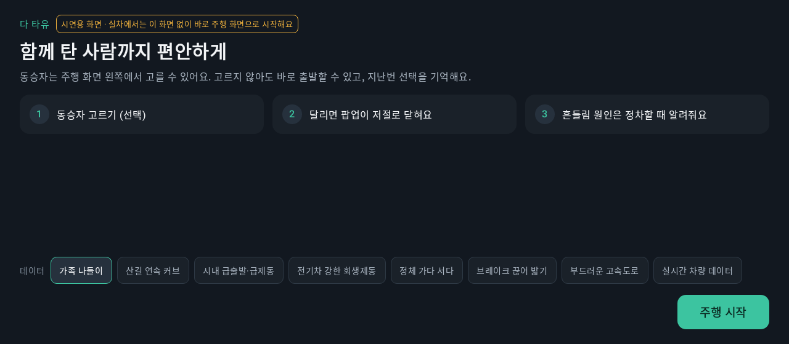
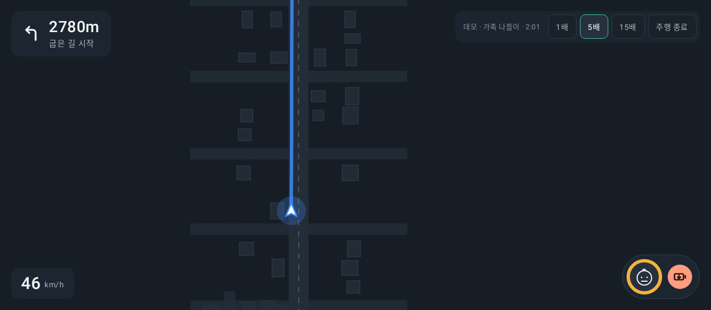
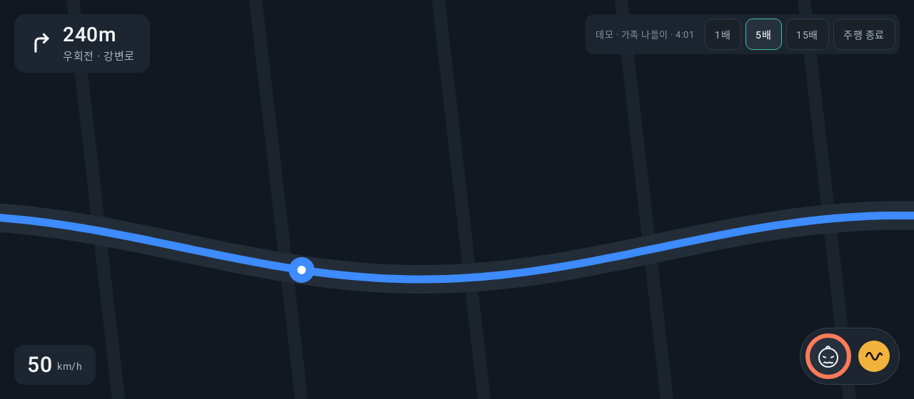
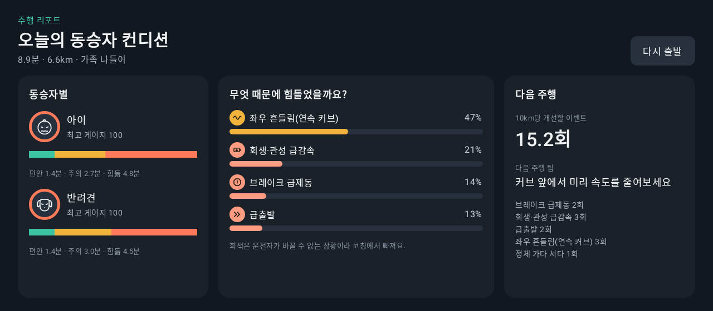
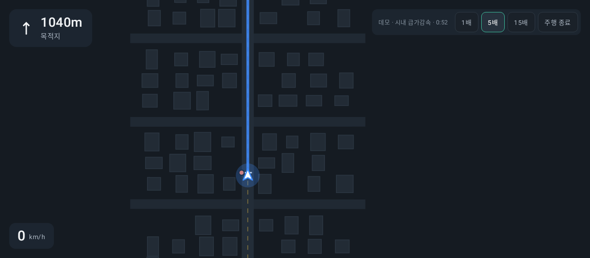
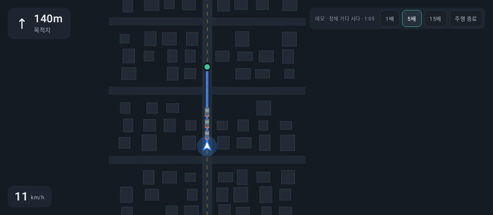
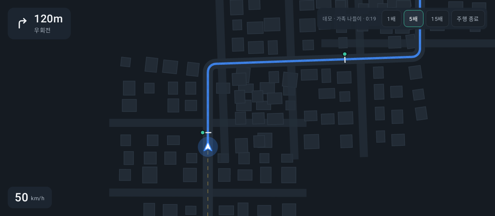
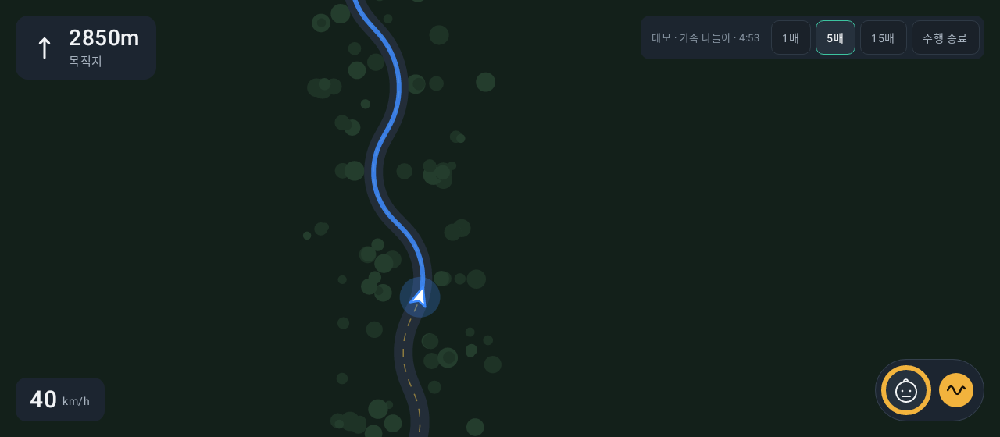

# 다타유 (DataYou)

> **"다 타유?"** — 운전자가 느끼지 못하는 동승자의 멀미를 데이터로 보여주는 Pleos Connect 앱

운전자는 차가 어떻게 움직일지 스스로 예측할 수 있어서 멀미를 잘 느끼지 못합니다. 하지만 뒷좌석의 아이, 임산부, 반려견은 다릅니다.

다타유는 Pleos Connect 내비게이션 뒤에서 조용히 동작합니다. 차량 데이터로 **동승자별 멀미 게이지**를 계산하고, **무엇 때문에** 힘든지(원인 7종)를 운전자에게 알려줍니다.

- 주행 중에는 동승자 아이콘과 원인 배지 1개만 보여줍니다. 텍스트는 없습니다.
- 정차하면 캐릭터와 한 줄 코칭을 보여줍니다.
- 하차하면 주행 리포트를 보여줍니다.

---

## 목차
- [동작 방식](#동작-방식)
- [원인 7종](#원인-7종)
- [Pleos Connect SDK / API 사용 계획](#pleos-connect-sdk--api-사용-계획)
- [AAOS 앱 (M2)](#aaos-앱-m2)
- [아키텍처·기능 개요 문서](#아키텍처기능-개요-문서)
- [인터랙티브 프로토타입](#인터랙티브-프로토타입)
- [빠르게 실행해 보기](#빠르게-실행해-보기)
- [시나리오 재생 결과](#시나리오-재생-결과)
- [프로젝트 구조](#프로젝트-구조)
- [마일스톤](#마일스톤)
- [한계와 검증 계획](#한계와-검증-계획)
- [설치 문제 해결 (AAOS 에뮬레이터)](docs/troubleshooting-aaos-install.md)

---

## 동작 방식

```
[차량 데이터]
  AAOS PERF_VEHICLE_SPEED · GEAR · IGNITION
  Pleos Vehicle SDK: Brake · TurnSignal · Steeringwheel · Odometer
  자이로(지원 차량) / GPS 방위각
        │
        ▼
[신호 처리]  앞뒤 가속도 · 급격함(jerk) · 좌우 가속도(= 속도 × 회전각속도)
        │
        ├──► [멀미 게이지]  0.1~0.5Hz 대역 흔들림 누적 + 순간 이벤트 가산 − 회복
        │                    (동승자별 민감도: 아이 · 임산부 · 어르신 · 반려견 …)
        ├──► [원인 분류 7종] 순간 4종 + 반복 2종 + 상황 1종
        └──► [예측 안내]    NaviHelper TBT: 게이지 '주의' 이상 + 300m 앞 회전 → 미리 감속
        │
        ▼
[알림]  주행 중: 효과음 1회 + 동승자 아이콘 + 원인 배지 1개
        정차 시: 캐릭터 애니메이션 + 코칭 카드 + Gleo TTS
        하차 후: 원인별 비율 · 10km당 이벤트 · 다음 주행 팁
```

### 멀미 게이지 (0~100)
- **누적:** 멀미 연구의 표준 모델인 ISO 2631-1은 약 0.2Hz 부근의 느린 흔들림에서 멀미가 가장 잘 생긴다고 봅니다. 다타유는 이를 **출발점**으로, 0.1~0.5Hz 대역의 앞뒤·좌우 가속도를 시간에 따라 누적합니다.
- **보정:** ISO 모델은 차량 멀미 예측에 한계가 있다고 알려져 있습니다. 그래서 다음 두 가지로 보완합니다.
  - 동승자 프리셋(민감도 배율)
  - 동승자 피드백("속 안 좋아" → 민감도 상승)
- **단계:** 편안 / 주의(40) / 힘듦(70). 내려갈 때는 히스테리시스를 적용해 단계가 깜빡이지 않게 합니다.
- **회복:** 부드러운 주행이 이어지면 게이지가 서서히 내려가고, 아이콘이 사라집니다.

### 주행 중 UI 규칙 (운전자 주의분산 최소화)
| 규칙 | 내용 |
|---|---|
| 배지 1개 | 지금 게이지에 가장 크게 기여한 원인 하나만 |
| 텍스트 없음 | 의미는 정차 카드와 온보딩에서 학습 |
| 30초 유지 | 배지가 깜빡이며 바뀌지 않도록 최소 유지 시간 |
| 대표 1명 | 동승자가 여럿이면 가장 힘든 한 명만 표시 |
| 효과음 | 게이지 단계가 올라가는 순간에만 1회 |

---

## 원인 7종

| 구분 | 원인 | 판별 기준 (초기값) | 코칭 |
|---|---|---|---|
| 순간 | 브레이크 급제동 | 감속 ≥ 3.0m/s², 0.3초 이상 + 브레이크 페달 ON | 조금 일찍, 약하게 |
| 순간 | 회생·관성 급감속 | 감속 ≥ 3.0m/s² + 브레이크 페달 OFF | 회생제동 단계 낮추기 |
| 순간 | 급출발 | 가속 ≥ 2.5m/s², 0.3초 이상 | 출발은 천천히 |
| 순간 | 급차선변경·급회전 | 좌우 ≥ 3.0m/s² (깜빡이 있으면 차선변경, 없으면 회전) | 여유 있게 |
| 반복 | 브레이크 끊어 밟기 | 60초간 브레이크 ON 6회 이상 + 최저속도 15km/h 이상 | 한 번에 부드럽게 |
| 반복 | 좌우 흔들림(연속 커브) | 30초간 좌우 가속 부호 전환 4회 이상 | 커브 앞에서 미리 감속 |
| 상황 | 정체 가다 서다 | 120초간 정지 3회 이상 + 최고속도 30km/h 이하 | **코칭 없음** (운전자 탓 아님) |

- 순간 이벤트의 임계값은 동승자별로 다릅니다(`eventThresholdScale`). 예를 들어 임산부는 0.75배라서 더 약한 급제동도 이벤트로 잡습니다.
- 모든 기준값은 [`EngineConfig.kt`](core-engine/src/main/kotlin/team/datayou/engine/EngineConfig.kt)에 모여 있습니다. 실주행 데이터로 보정할 예정입니다.

---

## Pleos Connect SDK / API 사용 계획

Pleos SDK 정책(*AAOS 표준 API가 있으면 표준 우선, 제조사 특화 기능은 Pleos SDK*)을 따릅니다.

| 구분 | API | 용도 | 상태 |
|---|---|---|---|
| AAOS | `PERF_VEHICLE_SPEED` | 가감속·jerk 계산 | ✅ |
| **Pleos Vehicle SDK 2.3.2** | `Brake` | 급제동 vs 회생 감속, 끊어 밟기 | ✅ (`check…Capabilities` 후 연결) |
| **Pleos Vehicle SDK** | `TurnSignal` | 급차선변경 vs 급회전 | ✅ |
| **Pleos Vehicle SDK** | `SteeringWheel` | 핸들 각도 → 회전 속도 → 좌우 가속 | ✅ |
| **Pleos Vehicle SDK** | `Odometer` | 리포트 주행거리, 10km당 이벤트 | ✅ |
| **Pleos NaviHelper SDK 3.0.5** | `addListener`(onTBTInfo), `getTBTInfo` | 다음 회전 예측 안내 | ✅ |
| AAOS (대체 경로) | `PERF_STEERING_ANGLE`, `TURN_SIGNAL_STATE` | Pleos 미탑재 환경에서 핸들·깜빡이 | ✅ |
| Android | GPS (`LocationManager`) | 실시간 지도 위치, 핸들 각도가 없을 때 좌우 판단 | ✅ |
| AAOS | `GEAR_SELECTION`, `IGNITION_STATE`, `PARKING_BRAKE_ON` | 주행 자동 시작·종료 | PT |
| AAOS | `CarUxRestrictionsManager` | 주행 중 화면 제약 연동 | PT |
| **Gleo AI SDK** | TTS (ON_DEVICE) | 정차 시 음성 코칭 (현재 Android TTS) | PT |
| Gleo AI SDK | STT, LLM | "속 안 좋아" 음성 보정, 리포트 요약 | Todo |
| Pleos Vehicle SDK | HVAC, Window | 외기 유입·창문 자동 케어 | Todo |

엔진 코드는 안드로이드에 의존하지 않습니다. SDK가 어떤 값을 주든 [`VehicleSample`](core-engine/src/main/kotlin/team/datayou/engine/model/Models.kt) 하나로 변환해 넣으면 됩니다. 차종별로 API가 없으면 해당 필드를 `null`로 두고, 엔진이 대체 경로로 동작합니다(예: 브레이크 정보가 없으면 급감속은 급제동으로 판정).

---

## AAOS 앱 (M2·M3)

엔진을 그대로 붙인 Android Automotive 앱입니다. 화면은 Jetpack Compose로 만들었습니다.

| 출발 · 동승자 선택 | 주행 중 · 주의 |
|---|---|
|  |  |
| **주행 중 · 힘듦 (연속 커브)** | **정차 시 · 코칭 카드** |
|  |  |
| **하차 · 주행 리포트** | |
|  | |

> 스크린샷은 `./gradlew :app:testDebugUnitTest`가 Robolectric으로 실제 Compose 화면을 렌더링한 결과입니다. 화면 값은 엔진이 '가족 나들이' 시나리오(아이 + 반려견)를 계산한 값입니다.

### 데이터 소스
| 선택 | 구현 | 용도 |
|---|---|---|
| 시나리오 (가족 나들이 등 7종) | `ReplayDataSource` | `sample-data` CSV를 10Hz로 재생, 1·5·15배속 |
| 실시간 차량 데이터 | `PleosVehicleDataSource` | AAOS 속도 + Pleos Vehicle SDK(브레이크·깜빡이·핸들·주행거리), 없으면 AAOS 표준 속성으로 대체 |
| 회전 안내 | `RouteNavigation` / `PleosNavigation` | 재생: 데이터에서 복원한 실제 회전 지점 · 실시간: NaviHelper TBT |

### 지도
- **시나리오 모드: 데이터로 그린 지도.** 각 시나리오의 속도·회전 데이터로 실제 지나간 길을 복원(추측 항법)하고, 그 길만 그립니다(`RouteGeometry`, `ScenarioMap`). 그래서 화면의 커브와 게이지 반응이 정확히 맞습니다. 도로 유형은 데이터로 자동 판별합니다.
  - 시내: 건물 블록·교차로·정지선과 신호등, 정체 시 앞차 행렬
  - 고속도로: 3차로·가드레일, 차선 변경은 한 차로 이동으로 표시
  - 굽이길(산길·강변): 숲 사이 2차로, 커브가 잘 보이도록 확대
  - 회전 안내(TBT)도 복원한 경로의 실제 회전 지점까지 거리입니다.
- **실시간 모드: 실제 지도.** OpenStreetMap 데이터의 어두운 지도(CARTO 타일)를 osmdroid로 띄우고 GPS 위치를 따라갑니다. 구글 서비스·API 키가 필요 없어 Pleos 에뮬레이터와 실차에서 동작합니다.
  - GPS가 움직이면(실차, 에뮬레이터 `⋯ ▸ Location ▸ Routes` 경로 재생) GPS 위치·방위를 쓰고, 차량 속도가 0이면 GPS 속도로 대신합니다.
  - GPS가 멈춰 있는데 차량 신호만 들어오면(`tools\sway_demo.bat`) 마지막 위치에서 속도·회전으로 추정 이동합니다. 이 경우 실제 도로를 따라가지는 않습니다.

| 산길 연속 커브 | 고속도로 급차선변경 |
|---|---|
|  |  |
| **시내 정차 (신호등)** | **정체 가다 서다 (앞차 행렬)** |
|  |  |
| **가족 나들이 · 교차로 우회전 안내** | **가족 나들이 · 강변 커브 (게이지 힘듦)** |
|  |  |

### 실행 방법
1. Android Studio에서 이 폴더를 엽니다. (`local.properties`는 자동 생성됩니다.)
2. Device Manager → **Automotive** 하드웨어로 AVD를 만듭니다. Pleos Connect Emulator나 Android Automotive 시스템 이미지 둘 다 됩니다.
3. `app` ▾ → Edit Configurations → **Install for all users**를 체크한 뒤 `app` 구성을 실행합니다. (또는 `tools\fix_install.bat` / `tools/fix_install.sh`)
4. 처음 실행하면 권한 창이 뜹니다. 차량 속도·핸들·위치 권한을 모두 **허용**하세요.
5. 실시간 모드 시연
   - 차량 신호 주입: `tools\sway_demo.bat` — 속도·핸들·깜빡이를 약 2분간 넣어 연속 커브와 급차선변경을 재현합니다(동승자 '아이' 권장).
   - 실제 도로 주행: 에뮬레이터 `⋯ ▸ Location ▸ Routes`에서 경로를 만들어 재생하면 실제 지도 위를 GPS로 달립니다.
   - 수동: 에뮬레이터 `⋯ ▸ Car data`에서 속도를 바꿉니다.

> ⚠️ **`Activity class {team.datayou.app/...MainActivity} does not exist` 에러가 나면**
> AAOS 멀티유저(시스템 0번 / 운전자 10번) 때문에 생기는 설치 문제입니다. 앱 코드 문제가 아닙니다.
> → [AAOS 에뮬레이터 설치·실행 문제 해결](docs/troubleshooting-aaos-install.md)

빌드된 APK: `./gradlew :app:assembleDebug` → `app/build/outputs/apk/debug/app-debug.apk`

## 아키텍처·기능 개요 문서

[`docs/overview/index.html`](docs/overview/index.html) — 주제별 10페이지 인터랙티브 문서입니다(개요, 시스템 아키텍처, 데이터 흐름, 멀미 게이지 시뮬레이터, 원인 7종, 화면 규칙, 데이터 채널과 SDK, 지도, 검증, 로드맵). 브라우저로 열거나 GitHub Pages로 볼 수 있습니다.

## 인터랙티브 프로토타입

[`docs/prototype/index.html`](docs/prototype/index.html)을 브라우저로 열면 차량 화면을 재생해 볼 수 있습니다. 파일 하나로 되어 있고, GitHub Pages로도 공개할 수 있습니다.

- 동승자를 고르고 출발하면 주행 중 아이콘 → 정차 카드 → 하차 리포트 순서로 화면이 흘러갑니다.
- 화면의 게이지·배지·카드는 손으로 만든 값이 아닙니다. `core-engine`이 시나리오 6종 × 동승자 5종을 실제로 계산한 타임라인(`timeline.json`)을 재생합니다.
- 다시 만들려면:
  ```bash
  ./gradlew :core-engine:run --args="timeline docs/prototype/timeline.json"
  python3 tools/build_prototype.py
  ```

## 빠르게 실행해 보기

필요한 것: JDK 17 이상 (Android Studio에 포함된 JBR이면 됩니다)

```bash
# 테스트 (20개)
./gradlew :core-engine:test

# 시나리오 목록
./gradlew :core-engine:run --args="list"

# 산길 연속 커브를 아이가 탄 상태로 재생
./gradlew :core-engine:run --args="scenario mountain_curves CHILD"

# 여러 동승자 (가장 힘든 사람이 대표로 표시됨)
./gradlew :core-engine:run --args="scenario city_aggressive PREGNANT,DOG"

# CSV 재생 (실주행 데이터도 같은 형식으로 변환해 사용)
./gradlew :core-engine:run --args="csv sample-data/ev_strong_regen.csv CHILD"
```

Windows에서는 `./gradlew` 대신 `gradlew.bat`을 쓰세요.

<details>
<summary>출력 예시 — 산길 연속 커브, 아이 동승</summary>

```
  19.7s  이벤트  좌우 흔들림(연속 커브)  (30초간 좌우 전환 4회)
  95.6s  ♪ 효과음 · 단계 상승 → CAUTION
  95.6s  [주행 중 표시] 아이 CAUTION 게이지 40 · 배지: 좌우 흔들림(연속 커브)
 168.5s  ♪ 효과음 · 단계 상승 → DISCOMFORT
 168.5s  [주행 중 표시] 아이 DISCOMFORT 게이지 70 · 배지: 좌우 흔들림(연속 커브)
 292.6s  [정차 카드] 아이가 많이 힘들어해요 · 좌우 흔들림(연속 커브) · 커브 앞에서 미리 속도를 줄여보세요

── 다타유 주행 리포트 ──
주행 4.9분 · 3.9km
[아이] 최고 게이지 100
  편안 1.6분 / 주의 1.2분 / 힘듦 2.1분
  - 좌우 흔들림(연속 커브): 100%
다음 주행 팁: 커브 앞에서 미리 속도를 줄여보세요
```
</details>

### CSV 형식
```
timestamp_ms,speed_mps,yaw_rate_rad_s,heading_deg,brake,turn_signal
0,0.0123,0.00041,90.00,0,OFF
```
빈 칸은 해당 센서가 없다는 뜻(`null`)입니다.

---

## 시나리오 재생 결과

합성 주행 데이터 9종을 아이 프로필로 재생한 결과입니다. 재현하려면 `./gradlew :core-engine:run --args="summary CHILD"`를 실행하세요.

| 시나리오 | 최고 게이지 | 감지된 원인 | 다음 주행 팁 |
|---|---|---|---|
| `family_trip` | 82 | 브레이크 급제동 2, 회생·관성 급감속 3, 급출발 1, 좌우 흔들림(연속 커브) 3, 정체 가다 서다 1 | 커브 앞에서 미리 속도를 줄여보세요 |
| `smooth_highway` | 0 | - | - |
| `city_aggressive` | 100 | 브레이크 급제동 6, 급출발 6 | 브레이크를 조금 일찍, 약하게 밟아보세요 |
| `ev_strong_regen` | 50 | 회생·관성 급감속 5 | 회생제동 단계를 한 단계 낮춰보세요 |
| `traffic_stop_and_go` | 13 | 정체 가다 서다 2 | - *(운전자 탓 아님)* |
| `brake_pumping` | 8 | 브레이크 끊어 밟기 2 | 한 번에 부드럽게 밟아보세요 |
| `mountain_curves` | 93 | 좌우 흔들림(연속 커브) 6 | 커브 앞에서 미리 속도를 줄여보세요 |
| `mountain_curves_gps_only` | 89 | 좌우 흔들림(연속 커브) 6 | 커브 앞에서 미리 속도를 줄여보세요 |
| `abrupt_lane_change` | 10 | 급차선변경·급회전 1 | 차선 변경과 회전은 여유 있게 해주세요 |

> 합성 데이터이므로 수치 자체보다 **원인이 의도대로 구분되는지**를 보여주는 용도입니다. 커브 시나리오는 실제 도로 형상(시속 40km, 반경 50~80m, 45~80도 커브)으로 만들어 지도에 그대로 그릴 수 있습니다. 자이로 없이 GPS 방위각만 써도 같은 결과가 나옵니다.

---

## 프로젝트 구조

```
data_you/
├── core-engine/                      # 순수 Kotlin 엔진 (Android 의존성 없음)
│   └── src/main/kotlin/team/datayou/engine/
│       ├── DataYouEngine.kt          # 진입점: process(sample) → EngineUpdate
│       ├── EngineConfig.kt           # 모든 임계값·계수 (보정 대상)
│       ├── model/                    # VehicleSample, Cause(7종), PassengerProfile
│       ├── signal/                   # 필터, 가속도·jerk·좌우 가속 계산
│       ├── dose/                     # 동승자별 멀미 게이지 + 원인 기여도
│       ├── cause/                    # 순간 이벤트 / 반복 패턴 판별
│       ├── report/                   # 하차 리포트
│       └── replay/                   # 합성 시나리오, CSV, 재생 CLI
├── sample-data/                      # 시나리오 CSV (에뮬레이터 주입·시연용)
├── docs/                             # 설계 문서, 설치 문제 해결, prototype/ (인터랙티브 HTML)
├── tools/                            # 프로토타입 빌드, 설치 복구, Pleos 진단, 좌우 흔들림 주입(sway_demo)
└── app/                              # AAOS 앱
    └── src/main/kotlin/team/datayou/app/
        ├── MainActivity.kt / DataYouViewModel.kt
        ├── data/                     # Replay·PleosVehicle 데이터 소스, RouteGeometry(경로 복원), LiveLocator(GPS), TBT
        └── ui/                       # Start / Drive(칩·정차 카드) / Report, ScenarioMap, LiveMap(OSM)
```

---

## 마일스톤

- [x] **M1 — 엔진**: 멀미 게이지, 원인 7종, 배지 규칙, 리포트, 시나리오 9종, 테스트 20개, 인터랙티브 프로토타입
- [x] **M2 — AAOS 앱**: 엔진 + Compose UI(출발 / 주행 중 / 정차 카드 / 리포트), CSV 재생·AAOS 실시간 데이터 소스, 효과음·TTS, 스크린샷 테스트, APK
- [x] **M3 — Pleos 연동 (코드)**: Vehicle SDK 4종·NaviHelper TBT 연결, AAOS 대체 경로, 데이터 기반 시나리오 지도, 실시간 OSM 지도, 차량 신호 주입 도구
- [ ] **M3 — 시연**: Pleos Connect Emulator 검증·시연 영상, Gleo TTS 교체
- [ ] **Todo**: Gleo STT·LLM, HVAC·Window 자동 케어, BLE 센서(위아래 흔들림), 멀미 위험 구간 지도

---

## 한계와 검증 계획

- **위아래 흔들림(방지턱·노면)은 측정하지 않습니다.** 차량 데이터로 얻을 수 없어서입니다. BLE 부착형 센서로 확장할 계획입니다.
- **기준값은 초기값입니다.** 스마트폰 로거로 실주행 데이터를 모아서 다음 순서로 보정합니다.
  1. 시내·산길·고속도로 데이터를 CSV로 수집
  2. 엔진에 재생
  3. 수동 라벨과 비교
- **GPS만 쓰는 경우의 한계:** 핸들 각도를 못 받는 차량은 GPS 방위각(약 1Hz)으로 좌우 가속을 추정합니다. 그래서 짧은 차선 변경은 놓칠 수 있습니다.
- **실시간 지도 타일:** 인터넷 연결이 필요합니다(OpenStreetMap·CARTO). 오프라인에서는 지도 없이 위치 화살표만 보입니다.
- **ISO 2631-1의 한계:** 이 모델은 차량 멀미 예측에 한계가 있다고 알려져 있습니다. 그래서 출발점으로만 쓰고 개인 보정으로 보완합니다.

### 참고 문헌
- ISO 2631-1:1997 — 전신 진동 평가 (멀미 누적량 MSDV)
- Bos, J. E. et al. (2022). TNO — 차량 멀미 예측에서 ISO 2631-1의 한계
- Diels, C. et al. SAE Technical Paper — 동승자 멀미와 차량 설계 지침
- Xie, W. et al. (2025). *Exploring the Effects of Regenerative Braking and the Auditory Cues for Alleviating Motion Sickness in Electric Vehicles*, IJHCI
- Henry et al. *Frontiers in Human Neuroscience* — 실차 0.2Hz 좌우 슬라럼과 차량 멀미(EEG)

---

*Hyundai Motor Group 차량용 앱 개발 공모전 출품작 · Team DataYou*
