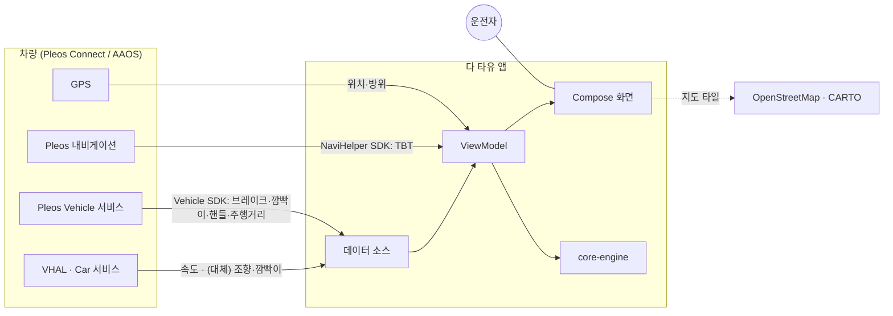
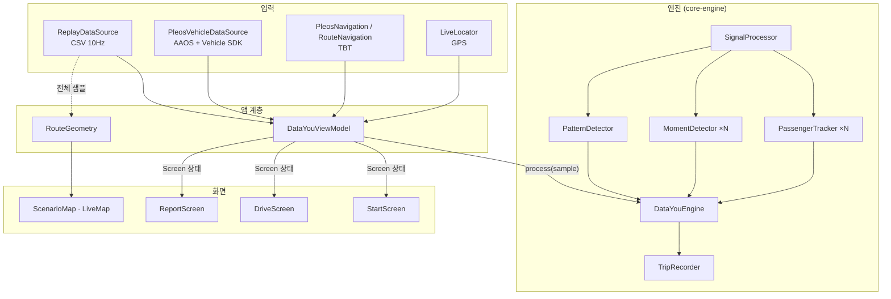
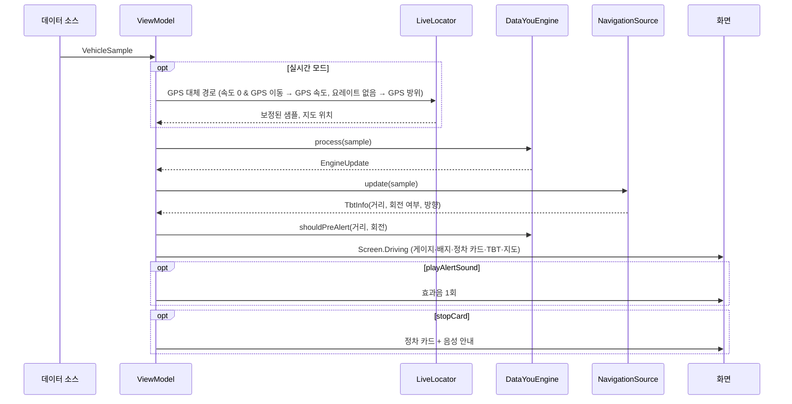
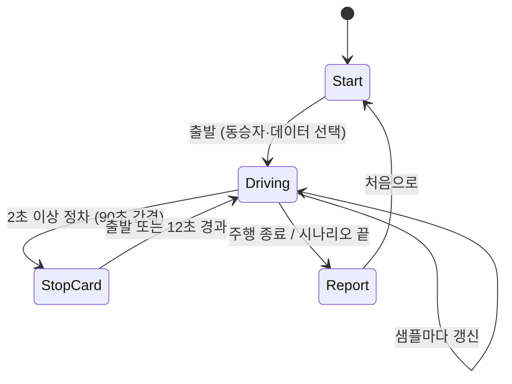

# 다 타유 (DataYou) 소프트웨어 설계 문서 (SDD)

| 항목 | 내용 |
|---|---|
| 문서 버전 | 1.1 (2026.11.15, 공모전 제출 기준) |
| 대상 | 심사위원, 개발자, 이후 기여자 |
| 범위 | `core-engine`(멀미 게이지·원인 판별 엔진)과 `app`(Android Automotive / Pleos Connect 앱) |
| 함께 보기 | [README](../../README.md) · [아키텍처·기능 개요(인터랙티브)](../overview/index.html) · [실행·시연 가이드](../guides/run-and-demo.md) |

---

## 1. 개요

### 1.1 목적
운전자는 차의 움직임을 스스로 예측하므로 동승자보다 멀미를 덜 느낍니다. 다 타유는 차량 데이터로 **동승자별 멀미 게이지**를 계산하고, 게이지를 올린 **운전 원인 7종**을 구분해 운전자에게 알려줍니다. 운전 중 주의분산을 늘리지 않도록, 주행 중에는 아이콘 하나만 보여주고 자세한 내용은 정차 시에만 보여줍니다.

### 1.2 범위
| 포함 | 제외 (향후) |
|---|---|
| 앞뒤·좌우 흔들림 기반 멀미 게이지, 원인 7종, 하차 리포트 | 위아래 흔들림(방지턱·노면) — 차량 데이터로 측정 불가 |
| Pleos Vehicle SDK 4종, NaviHelper TBT, AAOS 표준 속성, GPS | Gleo STT·LLM, HVAC·Window 자동 케어 |
| 시나리오 재생, 실시간 모드, 데이터 기반 지도, OSM 실시간 지도 | 주행 이력 저장·주간 리포트, 서버 |

### 1.3 용어
| 용어 | 뜻 |
|---|---|
| 게이지 | 동승자별 멀미 위험 0~100. 40 이상 '주의', 70 이상 '힘듦' |
| 원인(Cause) | 게이지를 올린 운전·상황 7종. 순간(MOMENT)·반복(PATTERN)·상황(SITUATION) |
| 배지 | 주행 중 동승자 얼굴 옆에 붙는 원인 아이콘 1개 |
| 정차 카드 | 차가 멈췄을 때 보여주는 원인·코칭 카드 |
| TBT | Turn-by-turn. 내비의 다음 회전 안내 |
| 요레이트(yaw rate) | 차가 수평으로 도는 속도(rad/s). 좌우 가속 = 속도 × 요레이트 |
| 대체 경로 | 어떤 채널을 못 받을 때 다른 값으로 대신 계산하는 방법 |

---

## 2. 요구사항

### 2.1 기능 요구사항
| ID | 요구사항 |
|---|---|
| FR-1 | 차량 속도·브레이크·방향지시등·핸들 각도(또는 GPS 방위)로 앞뒤·좌우 가속도를 10Hz로 계산한다 |
| FR-2 | 동승자 유형별(아이·임산부·어르신·반려견·멀미 민감·일반) 민감도로 게이지를 따로 계산한다 |
| FR-3 | 원인 7종을 구분한다: 브레이크 급제동, 회생·관성 급감속, 급출발, 급차선변경·급회전, 끊어 밟기, 연속 커브, 정체 |
| FR-4 | 정체처럼 운전자가 고칠 수 없는 상황은 운전자 탓으로 코칭하지 않는다 |
| FR-5 | 주행 중에는 가장 힘든 동승자 1명과 원인 배지 1개만 표시한다 |
| FR-6 | 배지는 최소 30초 유지하고, 효과음은 단계가 오를 때만 1회 낸다 |
| FR-7 | 게이지 '주의' 이상이고 다음 회전이 300m 이내면 예측 안내를 한다 |
| FR-8 | 정차 시 원인·코칭 카드와 음성 안내, 동승자 피드백 버튼을 보여준다 |
| FR-9 | 동승자 피드백으로 민감도를 보정한다(기본값의 0.5~2배) |
| FR-10 | 하차 시 원인별 횟수·기여 비율, 10km당 이벤트, 다음 주행 팁을 보여준다 |
| FR-11 | 녹화 시나리오(CSV) 재생과 실시간 차량 데이터를 같은 엔진으로 처리한다 |
| FR-12 | 시나리오 지도는 주행 데이터로 복원한 경로로, 실시간 지도는 실제 지도와 GPS로 그린다 |
| FR-13 | 이벤트가 생기면 동승자 캐릭터가 몸이 쏠린 방향의 자세로 바뀌고(주행 중 정지 자세, 정차 카드에서 동작 재생), 부드러운 주행이 이어지면 쉬는 표정을 보인다. 동작과 그림은 외부에서 주입할 수 있다 |

### 2.2 비기능 요구사항
| ID | 요구사항 | 설계 대응 |
|---|---|---|
| NFR-1  주의분산 | 주행 중 텍스트 없음, 한 번에 아이콘 하나, **주행 중 움직이는 요소 없음** | 표시 규칙(§7.7), `distractionOptimized` 선언, Android for Cars 앱 품질 기준 SA-1(주행 중 움직이는 그래픽 금지, 정차 중 운전과 관련된 애니메이션만 예외) — 화면 고정 여부를 스냅샷 픽셀 비교로 테스트 |
| NFR-2 차종 호환 | API 지원이 다른 차에서도 동작 | 채널별 지원 확인과 대체 경로(§6) |
| NFR-3 시험 가능성 | 차 없이 검증 | 엔진을 순수 Kotlin으로 분리, 시나리오·스냅샷 테스트 |
| NFR-4 보정 가능성 | 실주행 데이터로 기준값 조정 | 모든 기준값을 `EngineConfig` 한 곳에 |
| NFR-5 성능 | 헤드유닛에서 10Hz 실시간 | 샘플당 O(동승자 수) 계산, 할당 최소화 |
| NFR-6 개인정보 | 주행 데이터를 외부로 보내지 않음 | 서버 없음. 단, 실시간 지도 타일 요청에는 대략적 위치가 포함됨(§9) |

---

## 3. 시스템 구성

### 3.1 시스템 컨텍스트


### 3.2 모듈과 의존 규칙
| 모듈 | 언어·런타임 | 의존 | 역할 |
|---|---|---|---|
| `core-engine` | Kotlin/JVM 17, 외부 의존 없음 | 없음 | 신호 처리, 게이지, 원인 판별, 리포트, 시나리오, 재생 CLI |
| `app` | Kotlin, Android(AAOS) minSdk 28 / target 34, Compose | `core-engine`, Pleos SDK, `android.car`, osmdroid | 데이터 수집, 화면, 지도, 권한 |

규칙: **엔진은 Android 클래스를 import하지 않습니다.** 그래서 PC에서 바로 테스트하고, 같은 엔진을 시나리오 재생과 실차에 그대로 씁니다.

### 3.3 계층


### 3.4 패키지 구조
```
core-engine/src/main/kotlin/team/datayou/engine/
├── DataYouEngine.kt      진입점: process(sample) → EngineUpdate
├── EngineConfig.kt       모든 기준값·계수
├── model/                VehicleSample, MotionFrame, Cause, CauseEvent, PassengerProfile, Reaction
├── signal/               Filters(LowPass, BandPass), SignalProcessor, SteeringYaw
├── dose/                 PassengerTracker (게이지 + 원인 기여 장부)
├── cause/                MomentDetector, PatternDetector
├── report/               TripRecorder, TripReport
└── replay/               ScenarioBuilder, Scenarios, Csv, TimelineExport, ReplayCli

app/src/main/kotlin/team/datayou/app/
├── MainActivity.kt       런타임 권한, 화면 전환
├── DataYouViewModel.kt   흐름 조정, Screen 상태, 효과음·TTS, 대체 경로 적용
├── DataYouActions.kt     화면 → ViewModel 동작 인터페이스
├── data/                 VehicleDataSource, ReplayDataSource, PleosVehicleDataSource,
│                         PleosNavigation, RouteGeometry(+RouteNavigation), LiveLocator
└── ui/                   StartScreen, DriveScreen, ReportScreen, ScenarioMap, LiveMap, Icons, Theme
    └── anim/             캐릭터 반응 주입 (ReactionMotion, KeyframeReactionMotion, CharacterRenderer)
```

---

## 4. 데이터 모델

### 4.1 엔진 입력 `VehicleSample`
| 필드 | 형식 | 의미 | 없을 때 |
|---|---|---|---|
| `timestampMs` | Long | 샘플 시각 | 필수 |
| `speedMps` | Double | 속도 m/s | 필수 |
| `yawRateRadPs` | Double? | 요레이트, 왼쪽 + | `headingDeg`로 계산 |
| `headingDeg` | Double? | 방위(도) | 좌우 판단 생략 |
| `brakePedalOn` | Boolean? | 브레이크 페달 | 급감속을 모두 급제동으로 |
| `turnSignal` | OFF/LEFT/RIGHT | 방향지시등 | OFF로 간주 → 좌우 이벤트는 '급회전' |

CSV 형식(재생·실주행 공통): `timestamp_ms,speed_mps,yaw_rate_rad_s,heading_deg,brake,turn_signal` — 빈 칸은 `null`.

### 4.2 엔진 출력 `EngineUpdate`
| 필드 | 의미 |
|---|---|
| `passengers` | 동승자별 `PassengerState(profile, gauge, level)` |
| `focusPassenger` | 주행 중 표시할 가장 힘든 1명 |
| `badge` | 표시할 원인 1개 또는 null |
| `newEvents` | 이번 샘플에서 새로 감지된 `CauseEvent` |
| `playAlertSound` | 게이지 단계가 오른 순간 true |
| `stopCard` | 정차로 바뀐 순간의 `StopCard(passenger, level, cause, countSinceLastStop)` |
| `vehicleStopped`, `speedMps`, `timestampMs` | 상태 |
| `legacyAlert` | 원안 모드(N분 내 M회) 알림 조건 |
| `reaction` | 이번 샘플에서 시작하는 캐릭터 반응 `Reaction(kind, cause, 시각)` 또는 null |
| `resting` | 고칠 이벤트 없이 부드럽게 달리는 중(휴식 표정) |

### 4.3 리포트 `TripReport`
`durationMin`, `distanceKm`, `eventCounts`, `actionableEventsPer10Km`, 동승자별 `PassengerReport`(최고 게이지, 단계별 시간, 원인별 기여 비율), `events`, `topImprovement`, `smoothTrip`.

### 4.4 동승자 프리셋 `PassengerType`
| 유형 | 게이지 민감도 | 순간 이벤트 기준 배율 |
|---|---|---|
| 아이 | 1.4 | 0.9 |
| 임산부 | 1.5 | 0.75 |
| 어르신 | 0.8 | 0.8 |
| 반려견 | 1.3 | 0.9 |
| 멀미 민감 동승자 | 1.3 | 1.0 |
| 동승자(일반) | 1.0 | 1.0 |

어르신은 멀미 민감도는 낮게, 몸 쏠림 기준은 낮게(더 예민하게) 둡니다. 50세 이후 새로 생기는 멀미는 드물지만 급제동·급회전의 불편은 크다는 판단입니다.

---

## 5. 동작 흐름

### 5.1 샘플 하나의 처리 (10Hz)


### 5.2 화면 상태


---

## 6. 데이터 소스와 대체 경로

### 6.1 채널 매트릭스
| 채널 | 1순위 | 2순위 | 3순위 | 못 받으면 |
|---|---|---|---|---|
| 속도 | AAOS `PERF_VEHICLE_SPEED` | GPS 속도(차량 속도 0이고 GPS 이동 중) | — | 실시간 모드 불가 안내 |
| 브레이크 | Vehicle SDK `Brake.registerBrakePedalStatus` | — | — | 급감속 = 급제동 |
| 방향지시등 | Vehicle SDK `TurnSignal.registerTurnSignalState` | AAOS `TURN_SIGNAL_STATE` | — | 좌우 이벤트 = 급회전 |
| 핸들 각도 | Vehicle SDK `SteeringWheel.registerSteeringWheelAngle` | AAOS `PERF_STEERING_ANGLE` | GPS 방위 | 좌우 판단 생략 |
| 주행거리 | Vehicle SDK `Odometer.registerDistanceDriven` | 속도 적분 | — | — |
| 다음 회전 | NaviHelper `addListener`(onTBTInfo) + `getTBTInfo` | — | — | 예측 안내 생략 |
| 위치 | GPS(`LocationManager`) | 차량 신호로 추측 항법 | — | 위치 대기 표시 |

Pleos 정책(AAOS 표준 API가 있으면 표준 우선)에 따라 속도는 항상 AAOS에서 받습니다. Pleos SDK 값이 들어오면 같은 채널의 AAOS 대체 값보다 우선합니다.

### 6.2 Pleos Vehicle SDK 연결 절차 (`PleosVehicleDataSource`)
1. `Vehicle(context).initialize()` — 실패하면(일반 에뮬레이터) SDK 채널 전체를 건너뜁니다.
2. 채널마다 `check…Capabilities` → 지원하면 리스너 등록.
3. 서비스 연결이 비동기라 첫 호출이 실패할 수 있어, 미연결 채널은 1초 간격으로 최대 10번 재시도합니다.
4. 미지원으로 확인된 채널은 다시 시도하지 않고 화면에 `✗`로 표시합니다.
5. 콜백은 불규칙하게 오므로 마지막 값을 보관하고 10Hz 타이머로 `VehicleSample`을 만듭니다.

### 6.3 권한
| 권한 | 용도 | 런타임 요청 |
|---|---|---|
| `android.car.permission.CAR_SPEED` | 속도 | 예 |
| `android.car.permission.READ_CAR_STEERING` | 핸들 각도(AAOS) | 예 |
| `android.car.permission.CAR_EXTERIOR_LIGHTS` | 방향지시등(AAOS 대체) | 예 |
| `android.car.permission.CAR_POWERTRAIN` | 기어·시동(PT 범위) | — |
| `pleos.car.permission.CAR_DRIVE` | Brake, Odometer | 선언 |
| `pleos.car.permission.CAR_LIGHTS` | TurnSignal | 선언 |
| `ACCESS_FINE_LOCATION` | GPS 위치 | 예 |
| `INTERNET`, `ACCESS_NETWORK_STATE` | 지도 타일 | — |

`MainActivity`가 시작할 때 빠진 런타임 권한을 한 번에 요청합니다. 거부되면 실시간 화면에 이유(권한 없음 / 신호 미지원 / Car 서비스 없음)를 표시합니다.

---

## 7. 핵심 알고리즘

### 7.1 신호 처리 (`SignalProcessor`)
- 앞뒤 가속도: 속도를 저역통과(τ 0.25초) 후 미분, 다시 저역통과(τ 0.3초). 급격함(jerk)은 가속도의 미분.
- 좌우 가속도 = 속도 × 요레이트.
- 요레이트 출처 우선순위: 샘플의 `yawRateRadPs`(자이로 또는 핸들 각도 변환) → `headingDeg` 변화.
- **GPS 방위 처리:** 방위가 *새 값으로 바뀐 순간*끼리의 실제 간격으로 나눕니다. 1.5초 넘게 그대로면 직진으로 봅니다. (고정 주기로 나누면 1Hz 갱신과 어긋나 요레이트가 약 11% 부풀어 가짜 급회전이 생겼던 문제를 고친 방식이며, 회귀 테스트로 막아 둡니다.)

### 7.2 핸들 각도 → 요레이트 (`SteeringYaw`, 자전거 모델)
```
바퀴 조향각 δ = 핸들 각도 / 조향비(14.5)
요레이트 ω   = v · tan(δ) / 축간거리(2.9 m)      (|핸들| < 1.5° 는 0)
```
역변환(`steeringWheelDegFor`)은 시나리오를 에뮬레이터 조향각으로 주입할 때 씁니다.

### 7.3 멀미 게이지 (`PassengerTracker`)
```
bp      = BandPass(0.1–0.5 Hz)(가속도)        = LP(0.5Hz) − LP(0.1Hz)
dose    = (bp_long² + bp_lat²) × 0.18 × 민감도 × dt
event   = 순간 이벤트 +6 × 민감도, 반복 패턴 +4 × 민감도
recover = 파워 합 < 0.05 이고 순간 이벤트 없으면 −0.17 × dt
gauge   = clamp(gauge + dose + event − recover, 0, 100)
단계    = 40 이상 주의, 70 이상 힘듦 (내려갈 때 8만큼 히스테리시스)
```
ISO 2631-1의 멀미 누적 개념(약 0.2Hz에서 최대 민감)을 출발점으로 한 단순화 모델입니다. 수직 진동 기준인 ISO 모델은 차량 멀미 예측에 한계가 있다는 연구(Bos 외, 2022)가 있어, 앞뒤·좌우 방향과 개인 피드백 보정을 더했습니다.

### 7.4 순간 이벤트 (`MomentDetector`, 동승자별)
| 원인 | 조건 (기준값 × 동승자 배율) |
|---|---|
| 브레이크 급제동 | 감속 ≥ 3.0 m/s², 브레이크 켜짐 또는 정보 없음 |
| 회생·관성 급감속 | 감속 ≥ 3.0 m/s², 브레이크 꺼짐 |
| 급출발 | 가속 ≥ 2.5 m/s² |
| 급차선변경·급회전 | 좌우 ≥ 3.0 m/s². 직전 4초 안에 깜빡이가 켜졌으면 차선 변경, 아니면 회전 |

공통: 0.3초 이상 지속, 같은 원인 3초 쿨다운.

### 7.5 반복 패턴 (`PatternDetector`)
| 원인 | 조건 |
|---|---|
| 브레이크 끊어 밟기 | 시속 15km 이상에서 60초 안에 브레이크 6회 이상 |
| 좌우 흔들림(연속 커브) | 30초 안에 좌우 방향 전환 4회 이상(1.0 m/s² 이상인 흔들림만) |
| 정체 가다 서다 | 120초 안에 정지 3회 이상, 마지막 N번째 정지 이후 최고 시속 30km 이하 |

패턴 쿨다운 60초. 정체는 SITUATION으로 분류해 코칭하지 않습니다.

### 7.6 원인 기여도와 탓 돌리기
- 게이지 증가분을 원인별 장부에 적고 60초 시간 가중으로 감쇠시킵니다.
- 앞뒤 흔들림: 정체 중이면 '정체' → 끊어 밟기 패턴 중이면 '끊어 밟기' → 최근 30초 순간 원인.
- 좌우 흔들림: 최근 10초 급차선변경·급회전 → 아니면 '연속 커브'.

### 7.7 표시 규칙 (`DataYouEngine`)
| 규칙 | 값 |
|---|---|
| 대표 동승자 | 게이지가 가장 높은 1명 |
| 배지 | 기여도 1위 원인, 최소 30초 유지, 새 원인이 1.2배 이상일 때만 교체 |
| 효과음 | 단계가 오른 순간만 |
| 정차 판단 | 0.5 m/s 미만 2초 |
| 정차 카드 | 정차로 바뀐 순간, 90초 간격 |
| 예측 안내 | 단계 '주의' 이상 + 다음 회전 300m 이내 → 칩 테두리 파랗게 강조 (움직임 없음) |
| 원안 모드 | 10분 안에 순간 이벤트 3회 이상(옵션) |
| 캐릭터 반응 | 급출발 → 뒤로 젖힘, 급제동·회생·끊어 밟기 → 앞으로 쏠림, 급회전·커브 → 좌우 가속 반대 방향으로 기울어짐, 정체는 없음. 순간 이벤트 우선, 최소 2초 간격. **주행 중은 정지 자세로 2.5초 유지, 동작 재생은 정차 카드에서만** |
| 휴식 표정 | 편안 단계 + 시속 7km 이상 + 고칠 수 있는 이벤트 없이 60초 |

캐릭터 반응의 **동작과 그림은 앱 바깥에서 주입**합니다. 엔진은 `ReactionKind`만 정하고, 동작은 `ReactionMotion`(기본: JSON 키프레임, 우선순위 기기 파일 > assets > 내장), 그림은 `CharacterRenderer`가 맡습니다. 자세한 형식은 [캐릭터 애니메이션 설계·주입 가이드](character-animation.md)를 보세요.

### 7.8 경로 복원 (`RouteGeometry`, 재생 모드)
1. **추측 항법:** 방향 θ += 요레이트·dt(없으면 방위각 사용), 위치 += v·dt·(cos θ, sin θ).
2. **도로 유형:** 앞뒤 ±15초 창의 평균 속도와 평균 |요레이트|로 판정 — |ω| > 0.09 & v > 20km/h 굽이길, v > 70 고속도로, v > 42 간선도로, 그 밖 시내.
3. **차로 위치:** 큰 조향(|ω| ≥ 0.03) 구간을 뺀 ±150m 평균 방향을 도로 방향으로 보고, 그에 대한 옆 이동을 누적(±3.5m, 3km 감쇠). 차선 변경이 한 차로 이동으로 남습니다.
4. **정차 지점·정체:** 이동→정지 전환점, 주변 150m 안 정차 3회 이상이면 정체.
5. **안내 지점:** 50m 안에 60도 이상 꺾이면 교차로 회전, 굽이길 시작점, 마지막에 목적지.

`RouteNavigation`은 이 안내 지점까지의 실제 거리를 TBT로 줍니다. 그래서 재생 모드의 회전 안내·예측 안내·지도가 모두 데이터와 일치합니다.

### 7.9 실시간 위치 (`LiveLocator`)
- GPS가 2.5초 안에 갱신됐고 움직이는 중이면 GPS 위치·방위를 그대로 씁니다.
- 아니면 마지막 위치에서 차량 속도·요레이트로 추측 항법합니다(신호만 주입하는 시연용, 도로를 따라가지 않음).

---

## 8. 화면 설계

| 화면 | 주요 요소 | 근거 |
|---|---|---|
| 시작 | 동승자 다중 선택, 시나리오/실시간 선택 | — |
| 주행 | 지도, 회전 안내(방향 화살표·거리), 속도, 동승자 얼굴 + 원인 배지, 데모 막대(배속·채널 상태) | FR-5·6·7, NFR-1 |
| 정차 카드 | 원인·코칭 문구, 음성, "괜찮아요 / 속 안 좋아요" | FR-8·9 |
| 리포트 | 원인별 기여 막대·횟수, 10km당 이벤트, 다음 주행 팁, 칭찬 | FR-10 |

지도:
- **ScenarioMap**: `RouteGeometry`를 진행 방향이 위로 오도록 회전해 그립니다. 도로 유형마다 배경·도로 폭·차선·주변(건물, 들판, 숲)·확대 배율이 다르고, 정지선·신호등·앞차 행렬·목적지를 데이터에서 찾아 표시합니다.
- **LiveMap**: osmdroid + CARTO 어두운 타일(OpenStreetMap 데이터). 구글 서비스·API 키가 필요 없어 Pleos 차량에서도 동작합니다. 출처 표기를 항상 띄웁니다.

색은 단계(편안 초록 · 주의 노랑 · 힘듦 주황)와 함께 얼굴 표정으로도 구분해 색각 이상 운전자도 읽을 수 있게 했습니다.

---

## 9. 오류 처리와 보안·개인정보

| 상황 | 동작 |
|---|---|
| Car 서비스 없음 / 속도 권한 거부 / 속도 미지원 | 실시간 화면에 원인별 문구 표시, 앱은 계속 동작 |
| Pleos SDK 없음(일반 에뮬레이터) | SDK 채널을 건너뛰고 AAOS 대체 경로 사용 |
| 채널 미지원 | `✗` 표시 후 해당 기능만 생략(§6.1) |
| NaviHelper 경로 안내 없음 | TBT·예측 안내 생략, 5초 갱신 없으면 안내 해제 |
| GPS 없음 | "위치를 기다리는 중" 안내 |
| AAOS 멀티유저 설치 문제 | [설치 문제 해결 가이드](../guides/troubleshooting-aaos-install.md)와 `tools/emulator/fix_install` |

- 주행 데이터는 기기 밖으로 보내지 않습니다. 서버가 없습니다.
- 실시간 지도는 타일을 내려받을 때 지도 서버에 대략적인 위치(타일 좌표)가 전달됩니다.
- Gleo STT·LLM 같은 서버형 기능을 붙일 때 필요한 클라이언트 ID·시크릿은 저장소에 넣지 않고 `local.properties`(Git 제외)로만 주입합니다.

---

## 10. 설정값 (`EngineConfig`)
| 분류 | 값 |
|---|---|
| 신호 | 속도 τ 0.25초, 가속도 τ 0.3초 |
| 게이지 | 대역 0.1~0.5Hz, 이득 0.18, 조용함 기준 0.05, 회복 0.17/초, 주의 40, 힘듦 70, 히스테리시스 8 |
| 순간 이벤트 | 급제동 3.0, 급출발 2.5, 급회전 3.0 m/s², 지속 0.3초, 쿨다운 3초, 깜빡이 창 4초, 가산 +6 |
| 반복 패턴 | 끊어 밟기 60초·6회·15km/h, 정체 120초·3회·30km/h, 커브 30초·4회·1.0 m/s², 쿨다운 60초, 가산 +4 |
| 표시 | 기여 감쇠 60초, 배지 30초, 교체 1.2배, 정차 0.5 m/s·2초, 정차 카드 90초, 예측 안내 300m |
| 캐릭터 반응 | 반응 간격 2초, 휴식까지 60초, 휴식 최소 속도 2 m/s |
| 원안 모드 | 10분, 3회 |

모두 초기값이며 실주행 데이터로 보정합니다(§12).

---

## 11. 테스트 전략과 추적성

| 계층 | 도구 | 수 |
|---|---|---|
| 엔진 시나리오·규칙 | JUnit5 (`core-engine/src/test`) | 32 |
| 화면 스냅샷 | Robolectric + Roborazzi (`app/src/test`) | 5 |
| 시나리오 지도 스냅샷 | 〃 | 6 |
| 실시간 지도 렌더링 | 〃 | 1 |
| 캐릭터 반응 스냅샷·주행 중 고정·정차 재생 | 〃 | 7 |
| 애니메이션 주입(JSON·정지 자세·우선순위) | 〃 | 6 |

| 요구사항 | 대표 테스트 |
|---|---|
| FR-3 원인 구분 | 시내 급출발·급제동 분류 / 페달 없이 급감속 → 회생 / 깜빡이로 차선 변경 vs 회전 / 잦은 브레이크 → 끊어 밟기 |
| FR-4 정체 | 정체는 감지하되 운전자 탓으로 코칭하지 않는다 |
| FR-2 동승자 차이 | 어르신은 아이보다 게이지가 늦게 찬다 / 약한 쏠림도 이벤트로 잡는다 |
| FR-5·6 표시 규칙 | 가장 힘든 한 명 대표 / 배지 30초 유지 / 효과음은 단계 상승 시만 |
| FR-7 예측 안내 | 주의 이상이고 300m 안일 때만 |
| FR-9 피드백 | 민감도 상승, 범위 제한 |
| NFR-2 대체 경로 | 브레이크 정보 없음 → 급제동 / GPS 방위만으로 연속 커브 / 조향각만으로 연속 커브 / GPS 가짜 급회전 회귀 |
| FR-12 지도 | 차선 변경이 경로에 보임 / 시내는 시내·간선만 / 정체 구간 존재 / 우회전 안내 존재 |
| FR-13 캐릭터 반응 | 급출발 뒤로·급제동 앞으로 / 왼쪽 차선 변경 → 오른쪽 기울어짐 / 정체 제외 / 2초 간격 / 휴식 조건 / JSON 주입·우선순위 / 주입한 동작·그림 스냅샷 |
| NFR-1 주행 중 움직임 없음 | 주행 중 화면이 시간이 지나도 픽셀 단위로 같음 / 정차 카드만 움직임 |

합성 시나리오 9종은 실제 도로 형상(커브 반경 50~80m·회전각 45~80°, 교차로 90° 회전, 2.3초에 한 차로 이동)으로 만들었습니다. 결과는 [README](../../README.md#시나리오-재생-결과)에 있습니다.

---

## 12. 빌드·실행·검증 환경
| 항목 | 값 |
|---|---|
| 빌드 | Gradle 8.10, AGP 8.5, Kotlin 2.0, JDK 17 |
| SDK | Pleos Vehicle 2.3.2, NaviHelper 3.0.5 (공개 Maven `nexus-playground.pleos.ai`, 인증 불필요), osmdroid 6.1.20 |
| 실행 환경 | Android Automotive 에뮬레이터(API 34·35), Pleos Connect Emulator |
| 시연 도구 | `tools/emulator/sway_demo` — VHAL에 속도·핸들·깜빡이 주입 |

자세한 명령은 [실행·시연 가이드](../guides/run-and-demo.md)를 보세요.

---

## 13. 한계와 향후 과제
| 한계 | 계획 |
|---|---|
| 위아래 흔들림 미측정 | BLE 부착형 IMU 센서 |
| 기준값이 초기값 | 스마트폰 로거로 실주행(시내·산길·고속도로) 수집 → 재생 → 수동 라벨과 비교해 보정 |
| 검증 데이터가 합성 | 위와 같음 |
| GPS만 쓰면 짧은 차선 변경 놓칠 수 있음 | 핸들 각도·자이로 우선 |
| 음성이 Android 기본 TTS | Gleo AI TTS(기기 내) 교체 — PT 전 |
| 수동 시작·종료 | 기어·시동 신호로 자동화, 화면 제약 매니저 연동, 내비 위 오버레이 — PT 전 |
| 주행 이력 미저장 | 리포트 저장·주간 리포트·리포트 지도 |
