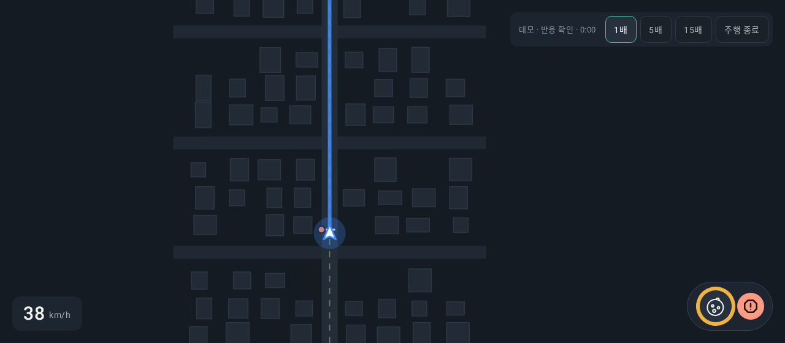
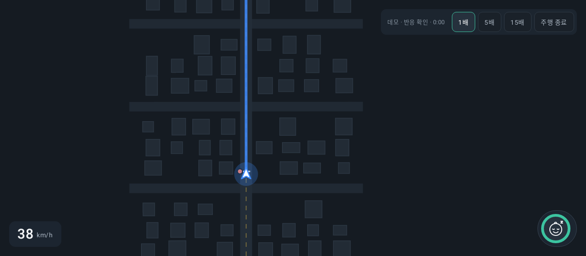
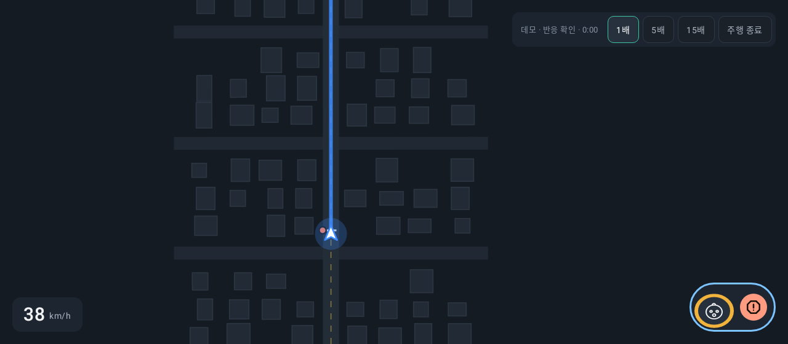
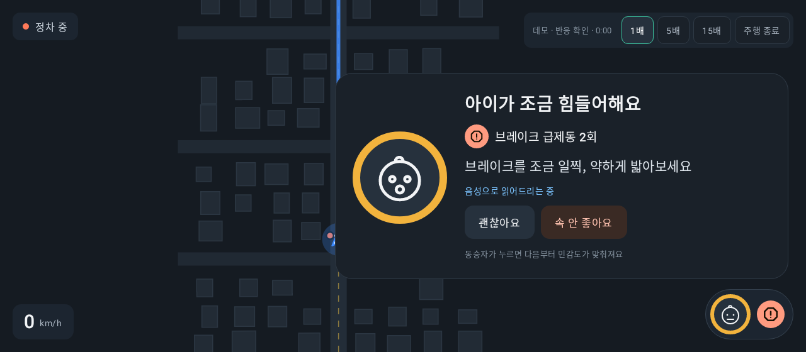
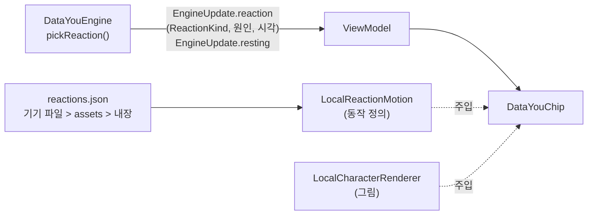

# 캐릭터 반응 애니메이션 — 설계와 주입 방법

이벤트가 생기면 동승자 캐릭터가 몸이 쏠리는 방향의 **자세**로 바뀝니다. 운전자가 글자를 읽지 않고도 "방금 무엇이 동승자를 흔들었는지" 알 수 있게 하는 피드백입니다.

**주행 중에는 움직이지 않습니다.** 움직임은 정차 후 정차 카드에서만 재생합니다. 시야 가장자리의 움직임은 정지한 아이콘보다 시선을 훨씬 강하게 끌기 때문이며, Android for Cars 앱 품질 기준 SA-1(주행 중 움직이는 그래픽 금지, 정차 중 운전과 관련된 애니메이션만 예외)을 따릅니다.

| 반응 (`ReactionKind`) | 원인 | 모습 |
|---|---|---|
| `LEAN_BACK` | 급출발 | 뒤로 젖혀짐 |
| `LEAN_FORWARD` | 브레이크 급제동, 회생·관성 급감속, 끊어 밟기 | 앞으로 쏠림 |
| `TILT_LEFT` / `TILT_RIGHT` | 급차선변경·급회전, 연속 커브 | 원심력 방향으로 기울어짐 (왼쪽으로 돌면 오른쪽으로) |
| (휴식 표정) | 고칠 수 있는 이벤트 없이 60초 이상 부드럽게 주행 | 눈 감고 미소 + z |
| — | 정체 가다 서다 | 반응하지 않음 (운전자 탓 아님) |

주행 중 (정지 자세):

| 앞으로 쏠림 | 뒤로 젖힘 | 오른쪽 기울어짐 | 휴식 | 예측 안내 (테두리 강조) |
|---|---|---|---|---|
|  |  |  |  |  |

정차 중 (동작 재생) · 주입 예시:

| 정차 카드에서 다시 보여주기 | 바깥에서 주입한 동작·그림 |
|---|---|
|  |  |

## 주의분산 정책
| 상황 | 보여주는 것 | 움직임 |
|---|---|---|
| 주행 중 반응 | 정지 자세(`holdPose`)로 바뀌어 2.5초 유지 후 원래대로. 표정은 놀람 | **없음** — 아이콘이 바뀌는 것과 같은 수준의 변화 |
| 주행 중 예측 안내 | 칩 테두리를 파랗게 강조 | **없음** (예전의 커졌다 작아지는 펄스를 없앰) |
| 부드러운 주행 | 휴식 표정(눈 감고 미소 + z) | 없음 |
| 정차 카드 | 그 원인의 반응 동작 전체를 두 번 재생 ("방금 이렇게 쏠렸어요") | 있음 — 정차 중이고 운전과 관련된 내용 |

- 반응 사이 최소 2초(`EngineConfig.reactionMinGapSec`) — 자세가 연달아 바뀌며 시선을 끌지 않게 합니다.
- 편안 단계에서도 반응 직후 2.5초간은 칩이 보였다가 사라집니다.
- 시스템 '애니메이션 줄이기'(애니메이터 배율 0)를 켜면 정차 카드에서도 움직이지 않습니다.
- 이 정책은 자동 테스트로 고정합니다: 주행 중 화면을 0.05~2.3초 사이 여러 시점에 찍어 **픽셀이 하나도 바뀌지 않는지**, 정차 카드는 **바뀌는지** 확인합니다.

## 구조: 무엇을 엔진이 정하고, 무엇을 주입하나



- **엔진(`core-engine`)**: 어떤 반응인지만 정합니다. 단위 테스트 8개로 고정합니다(`ReactionTest`).
- **동작(`ReactionMotion`)**: 진행률 0~1에서 자세(`MotionPose`: 앞뒤 숙임, 좌우 기울기, 이동, 크기)와 표정을 돌려줍니다. `holdPose`는 주행 중에 보여줄 정지 자세입니다(기본: 가장 크게 쏠린 순간).
- **그림(`CharacterRenderer`)**: 동승자 유형·단계·표정·크기를 받아 캐릭터를 그립니다. 기본은 Canvas 선 아이콘입니다.

코드: [`app/.../ui/anim/CharacterAnimation.kt`](../../app/src/main/kotlin/team/datayou/app/ui/anim/CharacterAnimation.kt)

## 주입 방법 1 — JSON (재빌드 없음)

`animations/reactions.json`을 아래 순서로 찾고, 처음 찾은 것을 씁니다. 형식이 틀리면 로그(`DataYouAnim`)만 남기고 다음으로 넘어갑니다. JSON에 없는 반응은 내장 기본값을 씁니다.

1. 기기 파일: `<앱 외부 파일 폴더>/animations/reactions.json`
2. 앱 assets: [`app/src/main/assets/animations/reactions.json`](../../app/src/main/assets/animations/reactions.json)
3. 내장 기본값 (`KeyframeReactionMotion.Default`)

에뮬레이터에 바로 넣기:
```bat
tools\emulator\push_animation.bat my_reactions.json
```
Automotive의 현재 사용자(보통 10번) 폴더에 넣고 앱을 다시 시작합니다. 되돌리려면 그 파일을 지우면 됩니다.

### 형식
```json
{
  "version": 1,
  "reactions": {
    "LEAN_FORWARD": {
      "durationMs": 650,
      "mood": "SURPRISED",
      "keyframes": [
        { "t": 0.00 },
        { "t": 0.20, "rotationX": 30, "dy": 7 },
        { "t": 0.55, "rotationX": -8, "dy": -2 },
        { "t": 1.00 }
      ],
      "hold": { "rotationX": 30, "dy": 7 }
    }
  }
}
```

| 필드 | 뜻 | 기본값 |
|---|---|---|
| `reactions` 키 | `LEAN_BACK`, `LEAN_FORWARD`, `TILT_LEFT`, `TILT_RIGHT` (다른 이름은 오류) | — |
| `durationMs` | 동작 길이, 0~3000 | 650 |
| `mood` | 동작 중 표정 `NORMAL` · `SURPRISED` · `RESTING` | `SURPRISED` |
| `keyframes[].t` | 진행률 0~1 | 필수 |
| `rotationX` | 앞뒤 숙임(도). + 앞으로, − 뒤로 | 0 |
| `rotationZ` | 좌우 기울기(도). + 오른쪽 | 0 |
| `dx`, `dy` | 이동(dp). + 오른쪽·아래 | 0 |
| `scale` | 크기 배율 | 1 |
| `hold` | 주행 중 정지 자세 (`rotationX`·`rotationZ`·`dx`·`dy`·`scale`) | 키프레임 중 가장 크게 쏠린 자세 |

키프레임 사이는 부드럽게(smoothstep) 보간합니다. 처음과 끝은 원래 자세(모두 0)로 두는 것을 권장합니다. 키프레임 동작은 정차 카드에서만, `hold`는 주행 중에 쓰입니다.

## 주입 방법 2 — 코드

```kotlin
// 동작 교체: 스프링, 물리 기반 등 원하는 방식으로 구현
class MyMotion : ReactionMotion {
    override fun durationMs(kind: ReactionKind) = 800
    override fun pose(kind: ReactionKind, progress: Float) = MotionPose(rotationZ = 20f * sin(progress * PI.toFloat()))
    override fun holdPose(kind: ReactionKind) = MotionPose(rotationZ = 20f)   // 주행 중 정지 자세
}

// 그림 교체: Lottie, 이미지, 3D 등
val myRenderer: CharacterRenderer = { type, level, mood, size, modifier ->
    MyLottieCharacter(type, mood, modifier.size(size))
}

CompositionLocalProvider(
    LocalReactionMotion provides MyMotion(),
    LocalCharacterRenderer provides myRenderer,
) { DriveScreen(state, actions) }
```

`MainActivity`는 시작할 때 `KeyframeReactionMotion.load(context)`로 JSON을 찾아 `LocalReactionMotion`에 넣습니다. 그림을 바꾸려면 같은 자리에서 `LocalCharacterRenderer`도 제공하면 됩니다.

## 테스트
| 테스트 | 확인하는 것 |
|---|---|
| `core-engine` `ReactionTest` (8) | 원인 → 반응 매핑, 기울어짐 방향, 정체 제외, 최소 간격, 휴식 조건 |
| `app` `ReactionMotionTest` (6) | JSON 파싱·기본값 대체, 보간, 정지 자세(`hold`), 잘못된 이름 거부, 기기 파일 > assets 우선순위, 깨진 파일 무시 |
| `app` `ReactionScreenshotTest` (7) | 각 반응의 정지 자세, 휴식 표정, **주행 중 화면이 시간이 지나도 그대로인지**, **정차 카드에서는 움직이는지**, 주입한 동작·그림이 쓰이는지 |
