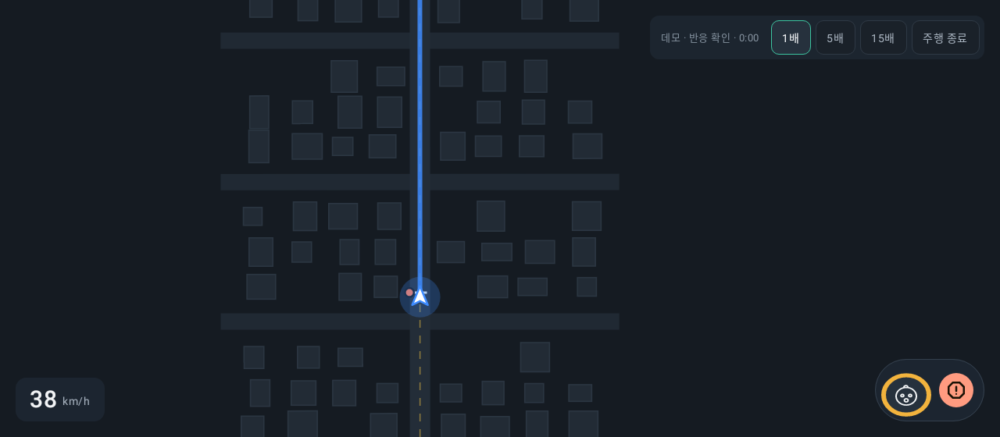
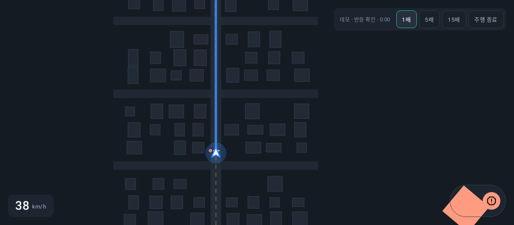
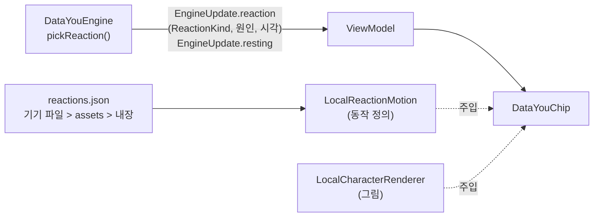

# 캐릭터 반응 애니메이션 — 설계와 주입 방법

주행 중 동승자 캐릭터는 몸이 쏠리는 방향대로 **짧게 한 번** 반응합니다. 운전자가 글자를 읽지 않고도 "방금 무엇이 동승자를 흔들었는지" 알 수 있게 하는 피드백입니다.

| 반응 (`ReactionKind`) | 원인 | 모습 |
|---|---|---|
| `LEAN_BACK` | 급출발 | 뒤로 젖혀짐 |
| `LEAN_FORWARD` | 브레이크 급제동, 회생·관성 급감속, 끊어 밟기 | 앞으로 쏠림 |
| `TILT_LEFT` / `TILT_RIGHT` | 급차선변경·급회전, 연속 커브 | 원심력 방향으로 기울어짐 (왼쪽으로 돌면 오른쪽으로) |
| (휴식 표정) | 고칠 수 있는 이벤트 없이 60초 이상 부드럽게 주행 | 눈 감고 미소 + z |
| — | 정체 가다 서다 | 반응하지 않음 (운전자 탓 아님) |

| 앞으로 쏠림 | 뒤로 젖힘 | 오른쪽 기울어짐 | 휴식 | 주입 예시 |
|---|---|---|---|---|
|  |  |  |  |  |

## 주행 중 표시 원칙과의 관계
- 반응은 이벤트가 생긴 순간 **0.65~0.7초 한 번**만 재생합니다. 반복 재생하지 않습니다.
- 반응 사이 최소 2초(`EngineConfig.reactionMinGapSec`) — 연달아 흔들리며 시선을 끌지 않게 합니다.
- 편안 단계에서도 반응 직후 2.5초간은 칩이 보였다가 사라집니다. 휴식 표정은 정지 화면입니다.
- 시스템 '애니메이션 줄이기'(애니메이터 배율 0)를 켜면 동작 없이 표정만 바뀝니다.

## 구조: 무엇을 엔진이 정하고, 무엇을 주입하나



- **엔진(`core-engine`)**: 어떤 반응인지만 정합니다. 단위 테스트 8개로 고정합니다(`ReactionTest`).
- **동작(`ReactionMotion`)**: 진행률 0~1에서 자세(`MotionPose`: 앞뒤 숙임, 좌우 기울기, 이동, 크기)와 표정을 돌려줍니다.
- **그림(`CharacterRenderer`)**: 동승자 유형·단계·표정·크기를 받아 캐릭터를 그립니다. 기본은 Canvas 선 아이콘입니다.

코드: [`app/.../ui/anim/CharacterAnimation.kt`](../../app/src/main/kotlin/team/datayou/app/ui/anim/CharacterAnimation.kt)

## 주입 방법 1 — JSON (재빌드 없음)

`animations/reactions.json`을 아래 순서로 찾고, 처음 찾은 것을 씁니다. 형식이 틀리면 로그(`DataYouAnim`)만 남기고 다음으로 넘어갑니다. JSON에 없는 반응은 내장 기본값을 씁니다.

1. 기기 파일: `<앱 외부 파일 폴더>/animations/reactions.json`
2. 앱 assets: [`app/src/main/assets/animations/reactions.json`](../../app/src/main/assets/animations/reactions.json)
3. 내장 기본값 (`KeyframeReactionMotion.Default`)

에뮬레이터에 바로 넣기:
```bat
tools\emulator\push_animation.bat my_reactions.json
```
Automotive의 현재 사용자(보통 10번) 폴더에 넣고 앱을 다시 시작합니다. 되돌리려면 그 파일을 지우면 됩니다.

### 형식
```json
{
  "version": 1,
  "reactions": {
    "LEAN_FORWARD": {
      "durationMs": 650,
      "mood": "SURPRISED",
      "keyframes": [
        { "t": 0.00 },
        { "t": 0.20, "rotationX": 30, "dy": 7 },
        { "t": 0.55, "rotationX": -8, "dy": -2 },
        { "t": 1.00 }
      ]
    }
  }
}
```

| 필드 | 뜻 | 기본값 |
|---|---|---|
| `reactions` 키 | `LEAN_BACK`, `LEAN_FORWARD`, `TILT_LEFT`, `TILT_RIGHT` (다른 이름은 오류) | — |
| `durationMs` | 동작 길이, 0~3000 | 650 |
| `mood` | 동작 중 표정 `NORMAL` · `SURPRISED` · `RESTING` | `SURPRISED` |
| `keyframes[].t` | 진행률 0~1 | 필수 |
| `rotationX` | 앞뒤 숙임(도). + 앞으로, − 뒤로 | 0 |
| `rotationZ` | 좌우 기울기(도). + 오른쪽 | 0 |
| `dx`, `dy` | 이동(dp). + 오른쪽·아래 | 0 |
| `scale` | 크기 배율 | 1 |

키프레임 사이는 부드럽게(smoothstep) 보간합니다. 처음과 끝은 원래 자세(모두 0)로 두는 것을 권장합니다.

## 주입 방법 2 — 코드

```kotlin
// 동작 교체: 스프링, 물리 기반 등 원하는 방식으로 구현
class MyMotion : ReactionMotion {
    override fun durationMs(kind: ReactionKind) = 800
    override fun pose(kind: ReactionKind, progress: Float) = MotionPose(rotationZ = 20f * sin(progress * PI.toFloat()))
}

// 그림 교체: Lottie, 이미지, 3D 등
val myRenderer: CharacterRenderer = { type, level, mood, size, modifier ->
    MyLottieCharacter(type, mood, modifier.size(size))
}

CompositionLocalProvider(
    LocalReactionMotion provides MyMotion(),
    LocalCharacterRenderer provides myRenderer,
) { DriveScreen(state, actions) }
```

`MainActivity`는 시작할 때 `KeyframeReactionMotion.load(context)`로 JSON을 찾아 `LocalReactionMotion`에 넣습니다. 그림을 바꾸려면 같은 자리에서 `LocalCharacterRenderer`도 제공하면 됩니다.

## 테스트
| 테스트 | 확인하는 것 |
|---|---|
| `core-engine` `ReactionTest` (8) | 원인 → 반응 매핑, 기울어짐 방향, 정체 제외, 최소 간격, 휴식 조건 |
| `app` `ReactionMotionTest` (5) | JSON 파싱·기본값 대체, 보간, 잘못된 이름 거부, 기기 파일 > assets 우선순위, 깨진 파일 무시 |
| `app` `ReactionScreenshotTest` (5) | 각 반응의 순간 자세, 휴식 표정, 주입한 동작·그림이 실제로 쓰이는지 |
