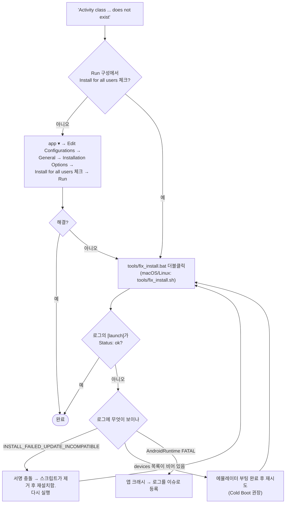

# AAOS 에뮬레이터 설치·실행 문제 해결

Android Studio에서 `app`을 실행했는데 아래 에러가 나는 경우의 대처법입니다.

```
Error running 'app'
Activity class {team.datayou.app/team.datayou.app.MainActivity} does not exist
```

앱 코드 문제가 아닙니다. APK 안에는 `MainActivity`가 런처 액티비티로 들어 있습니다(`aapt2 dump xmltree`로 확인). **에뮬레이터의 어느 사용자에게 앱이 설치됐는지**의 문제입니다.

## 왜 생기나

| 원인 | 설명 | 해당 환경 |
|---|---|---|
| ① 멀티유저 | Android Automotive는 시스템 사용자(0번)와 실제 화면에 보이는 운전자 사용자(보통 10번)를 함께 실행합니다. 앱이 한쪽 사용자에게만 설치되고 다른 사용자로 실행되면 "does not exist"가 납니다. | Android Studio + AAOS 에뮬레이터(API 33+) 전반. 실차·Pleos 에뮬레이터도 같은 구조입니다. |
| ② 서명 충돌 | 저장소에 배포한 `dist/*.apk`와 각자 PC에서 빌드한 APK는 디버그 키가 다릅니다. 하나를 설치한 뒤 다른 하나를 덮어쓰면 설치가 실패하고, 실패한 상태로 실행을 시도합니다. | 배포 APK와 직접 빌드를 섞어 쓴 경우 |
| ③ 설치 중단 | 메모리가 부족하면 설치 도중 에뮬레이터가 멈추고, 설치가 덜 끝난 채 남습니다. | AVD RAM 2GB(기본값) 환경 |

실제 진단 로그(개발 환경)에서는 사용자 0과 10이 모두 실행 중이었고, 현재 사용자는 10이었습니다. 모든 사용자에게 다시 설치한 뒤 바로 해결됐습니다.

## 대처 흐름



### 1. Android Studio 설정 (권장, 한 번만)
`app` ▾ → **Edit Configurations…** → **General** → Installation Options → **Install for all users** 체크 → OK → ▶ Run

배포 APK가 이미 설치돼 있으면 "기존 앱을 제거할까요?"가 뜰 수 있습니다. **OK**를 누르세요(서명이 달라서 묻는 것입니다).

### 2. 스크립트로 진단·재설치
Windows는 `tools\fix_install.bat`, macOS/Linux는 `tools/fix_install.sh`를 실행합니다.

1. 사용자 목록과 현재 사용자 확인
2. 기존 앱을 **모든 사용자에서** 제거 (서명 충돌 해소)
3. `adb install -r -g --user all`로 모든 사용자에게 설치 (권한 자동 허용)
4. 런처 액티비티 확인 → 현재 사용자로 실행
5. 크래시 로그 수집 → `dist/fix_install_log.txt`에 저장 (Windows)

APK는 직접 빌드한 `app/build/outputs/apk/debug/app-debug.apk`를 우선 사용합니다. 없으면 `dist/datayou-m2-debug.apk`를 사용합니다.

### 3. 수동 명령
```bash
adb shell pm list users                 # 0(시스템), 10(운전자) 확인
adb shell am get-current-user           # 보통 10
adb uninstall team.datayou.app
adb install -r -g --user all app-debug.apk
adb shell am start --user current -n team.datayou.app/.MainActivity
```

## 예방
- AVD RAM은 4GB 이상, 설치 전 **Cold Boot**
- 배포 APK와 직접 빌드를 섞지 말 것. 섞었다면 위 스크립트로 정리
- 심사·시연 PC에서는 `fix_install` 스크립트로 설치하는 것을 기본 절차로 사용
